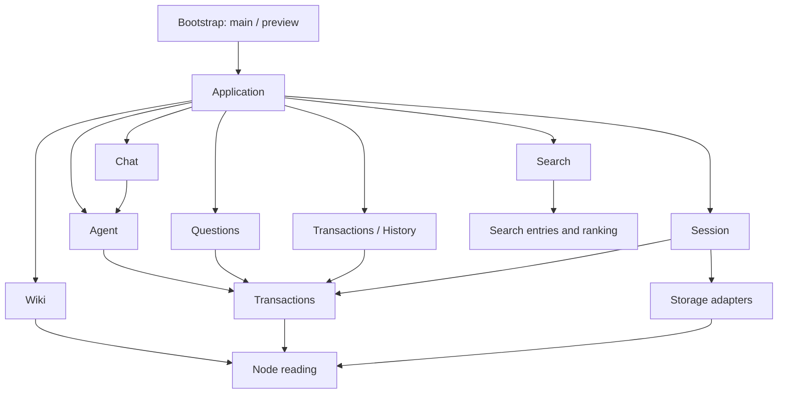
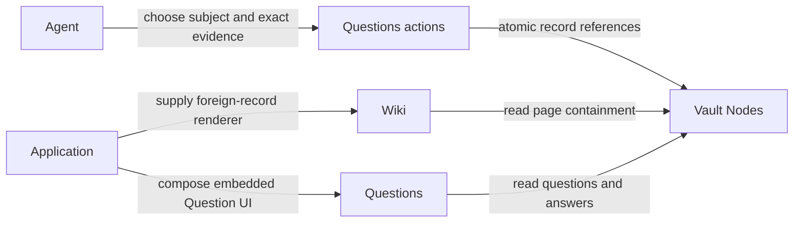

# Architecture

Application composes independently owned modules. A code dependency points from a caller to the
module whose interface it uses. A relationship stored between Nodes does not create a dependency
between their owning modules. Agent chooses those relationships; Application wires the available
record actions, readers and renderers into Agent and the views.



The graph shows the principal code dependencies. All UI owners may compose the public kit; record
modules may use Settings, Navigation and Runtime where needed. Those supporting modules never
import their consumers. No workflow imports a sibling workflow, including through a type-only
reference. Only the explicit Application composition entries and their integration tests combine
workflows. There is no extension registry, common workflow manifest or runtime feature toggle.

| Owner | Responsibility | Does not own |
|---|---|---|
| Application | Routes, shell, identities, module selection, record/tool/source composition | Record schemas or persistence |
| Agent | Execution, context discovery, grounding choices, durable tool activity, recovery, historical decoding | Wiki or Question payload interpretation |
| Chat | Conversations, messages, drafts, capture, projecting typed Agent activity into a transcript | Decoding Agent records |
| Wiki | Pages, blocks, citations, subject discovery and page presentation | Creating or answering Questions |
| Graph | Relationships, vocabulary Terms, snapshot traversal, live Query evaluation and exploration UI | Wiki page membership or presentation, persistence |
| Questions | Question/Answer records, action admission, atomic references, collection and embedded UI | Wiki classification or deciding which evidence to use |
| Transactions / History | Write lifetimes, acceptance/recovery state, history and guarded compensation | Producer-specific admission or undo policy |
| Session | Credentials, unlocking, adapter creation/replacement and cache lifetime | Record meaning |
| Storage | Node persistence, caches and GitHub transport | Features, credentials UI or record meaning |
| UI kit | Generic presentation, controls, focus, scrolling, responsive layout and styling | Routes, preference storage or record interpretation |
| Settings / Navigation / Search / Runtime | Preferences and settings binding / routes and commands / search interaction / scheduling and service worker | Workflow composition |

```text
app/
  main.tsx                   production bootstrap and adapter selection
  application/
    index.tsx                mounted shell and module views
    composition.ts           record sources, tools, publication rules and independent caller factories
    identities.ts            stable configured authors and atomic bootstrap
    routes.ts                application destinations
    Frame.tsx                navigation choices supplied to the kit
    AppearanceSettings.tsx   application appearance preferences
    Previews.tsx              delegated document previews
  agent/                     execution, discovery, historical reading, tools, providers and recovery
  workflows/
    chat/                    conversations, messages, capture and Chat UI
    wiki/                    pages, blocks, citations, subjects and Wiki UI
    graph/                   relationships, vocabulary, snapshot traversal and live queries
    questions/               Question/Answer actions, reading, tools and record UI
  navigation/                generic hash routes, command contracts and keyboard dispatch
  search/                    search interaction and device-local recent destinations
  settings/                  validated device preferences and module settings binding
  runtime/                   scheduling, cancellation and offline application cache
  transcription.ts           shared recording sessions and microphone lifetime
  vault/
    nodes/                   immutable model, acceptance, snapshots and memory adapter
    transactions/            scoped write lifetime, recovery and History UI/compensation
    content/                 content operations, tools and recorded action receipts
    records/                 retained kinds awaiting modules and their source reading
    sources.ts               generic historical source-reading contract
    session/                 credentials, encryption and file/Node adapter lifetime
    storage/
      nodes/                 GitHub transaction persistence
      github-client/         shared GitHub transport
  ui/kit/                    public generic presentation and its private implementation
  preview/                   fictional adapters and examples
tools/
  architecture/              compiler-resolved dependencies, cycles and kit composition checks
  build/                     build-time dynamic-code guard and credential sealing
  preview/                   live Agent proxy and sample preview packaging/publishing
  testing/                   focused-test and CI-only runner guards
  browser/                   browser integration specs and fixtures
  production/                built production browser specs and runner configuration
  check.ts                   standalone source-file integrity checks
  vault-check/               private Vault source-note/schema/graph checking
```

`app/ui/` contains only the kit. Shared application behavior has named owners: for example,
Settings binds preferences to kit controls, Search binds results and commands to a kit overlay,
and Application selects navigation entries for the kit's layout. Module-owned record UI stays
beside the record it interprets, as required by [ADR 0006](docs/adr/0006-module-ui-and-shared-presentation.md).

## Wiki, Questions and Agent



Wiki and Questions do not call one another or consume one another's reading interfaces.
Questions accepts a generic live Node as its optional subject and exact Node addresses for source
and knowledge evidence. It validates availability, schema, attribution and atomic publication.
Agent discovers Wiki subjects and classifies evidence through owner-supplied readers composed by
Application. Agent's grounding reads remain conflict expectations until the Question is accepted.
The historical tool names `listQuestionSubjects` and `listQuestionContext` belong to Agent discovery;
Questions owns `askQuestion`, `readQuestion` and `listQuestions`.

Wiki receives a generic foreign-record renderer. Application dispatches a Question record to the
Questions-owned embedded UI and supplies its actions. Rendering a record in a Wiki page therefore
adds no Wiki-to-Questions code dependency. The stored subject and evidence references connect data;
Agent makes the choice, Questions records it, and each view reads through its own interface.

## Adding or removing a workflow

Create a folder under `app/workflows/` with its views, operations, state, adapters and tests.
Expose ordinary named functions and views, such as Questions' creation/answering actions. External
inputs are validated by the owning module. Wire views, routes and navigation in
`application/index.tsx`; wire readers, tools and publication rules in `application/composition.ts`.
Module integration tests live in `app/application/`.

Remove a workflow by deleting its folder and Application wiring. Persisted Nodes remain in the
Vault; remaining readers retain their generic unknown-record behavior. History is core Transaction
infrastructure under `vault/transactions/history/`, as decided in ADR 0009. The browser stores
application data only as Nodes. Renaming a Node means appending changed content to the same stable identity;
it does not require a separate module or rewriting identity references.

Modules define their configuration through `SettingsDefinition` in `app/settings/store.ts`: field keys,
labels, defaults, kinds, suggested choices, custom-value support and parsing. Agent owns invocation
settings, Chat owns instructions, and
OpenAI, GitHub storage and Jina own implementation-specific options and settings views. Session owns
safe credential state, replacement/restore/clear actions and their React controls; provider views
supply field meaning and consume those handles. The shared preference store validates device
preferences; `ModuleSettings` renders ordinary definitions through public kit controls. OpenAI's
settings and execution share one preference instance. Appearance uses the same definition with the
kit's theme control. Application passes `{ name, content }` entries to `SettingsMenu`. Removing a module also removes
its entry. Modules without preferences need no empty settings section.

`tools/architecture/layout.test.ts` checks compiler-resolved imports, re-exports, dynamic imports and import-type
expressions. Workflow isolation and production/fixture separation include type-only references.
Value and dynamic import cycles are rejected separately; type cycles do not imply runtime cycles.
Raw persistence and session construction remain restricted even through aliases. The checker also
keeps standalone source checking out of the browser, prohibits imports back into Application, and
keeps UI callers on public kit exports. The kit owns presentation; lower-level record and persistence
implementations cannot import views.

Record ownership includes publication. Questions owns the complete creation and answering actions:
payload validation, suggested-answer shape, direct Answer evidence, required reads and atomic
changes. Callers request those actions through Application composition. Pure preparation entries remain
available to the private Vault's translation, but do not authorize new application writes. The
Questions ownership factory is private to Application and Questions; copying valid-looking payloads,
setting a transaction kind or using the same author does not confer permission to publish.

Every Application entry supplies an enforcing NodeStore, including independent Agent and Chat
construction. Questions privately retains its action-produced work through entered publication and
exact save retries. A generic publication rule runs against authoritative history at acceptance in
both memory and GitHub adapters. Persistence owns structural integrity; Questions owns interpretation
and admission of Question, Answer and task Relationship changes. An unauthorized change rejects the
whole Transaction, including when bundled with initial Chat and Agent records. Historical loading
and identical already-accepted retries retain their existing behavior.

Raw node adapters and acceptance/loading functions are private to bootstrap, persistence and
historical fixtures. Session hooks exposing raw handles remain with Vault session assembly and
Application; preview fixtures cannot be imported by production callers. The compiler-backed layout policy
checks these resolved origins through aliases and re-exports, while permitting ordinary node reads
and errors. Keeping those handles out of task
code prevents a new producer from bypassing the Application-supplied interface. This deepens the
Questions module at its existing seam: callers gain leverage from two actions, and validation,
construction, ownership and tests retain locality within Questions.

## Node-only application data

Session opens one Node adapter and exposes managed Transaction reading/writing. It admits the
application after a cached snapshot or successful remote refresh, including an empty vault.
Cold-load errors stay on the opening screen; cached data stays readable through refresh failures
or offline use. GitHub credential replacement prepares and validates only the Node adapter before
activating it. Search receives Wiki entries and starts empty while that reading is loading.

The browser has no file backend, file staging, Markdown fallback or schema startup gate. Chat
submits node messages directly after admission; pending node persistence still uses its existing
recovery actions. Shared search entries/ranking live in Search, safe URLs in Navigation, and
Markdown rendering in Chat.

The private Vault's existing source CI can still call `tools/check.ts`. Its note/schema/graph
implementation lives in `tools/vault-check/`, outside the browser dependency graph. Translation
and enrichment remain owned by the private Vault under ADR 0007. Removing application file
support does not delete or rewrite files in the private repository.

## Conversation lifetime

Application creates one node-backed Chat interaction above route selection, scoped to its owning Vault
session. Chat owns draft revisions, submission intent, selected conversation and pending
selection, prompt consumption, record interpretation, recovery presentation and unread acknowledgement.
The page, pane, chooser and application commands request these tasks through the same interface.
Closing a view keeps task state and accepted execution; focus and chooser disclosure stay mounted
presentation state. Unsubmitted drafts survive navigation within the session, without new
reload persistence. Accepted history is reconstructed through NodeStore without executing Agent.

`prepareSubmission()` returns a blocked reason or locally owned request with its
completion. It rechecks current admission before handoff. Chat retains stable text/identity
before clearing only the source draft revision; local ownership does not claim durable acceptance.
New/Open share selection permission across commands, routes and chooser. The latest eligible
selection wins; blocked intents preserve valid work, Open preserves draft, and New creates an unsaved
identity. Application uses selection outcomes for navigation and reconciles failed/blocked routes.

Chat claims each application prompt once. Eligible Ask uses the same preparation path. Editable
fallback fills the draft without queued execution; capture conflicts retain text with explicit
Use/Dismiss actions. Reopening or simultaneous views cannot reclaim a prompt. An unseen completed
reply remains unread through failed reads/save recovery until an open view acknowledges it.

Application supplies capabilities, navigation and a stable session scope. Same-session updates apply to
subsequent explicit work while active execution retains its original backend and recording its admitted
provider. Session replacement and React effect replay create fresh owners. Destruction is terminal,
releases local execution/subscriptions and recording admitted by Chat, and invalidates late task/route
callbacks. Chat borrows injected Transcription; it never disposes another owner's recording module or
cancels independently admitted capture. Entered acceptance/effects retain their independent obligations.

Agent independently owns effective context, run and tool records. Chat and Agent construct their own
initial records, composed into one transaction before model/tool effects. Chat's local append queue
covers preparation and initial acceptance only, never the whole execution. Agent has no whole-Vault
lifetime queue. Module tools own validation and publication policy; invocation and outcome acceptance
gate effects and continuation. Failed outcome persistence pauses work and retries saving the known
result without replay. Stop expires tools, drains entered effects and retains accepted content and
pending save obligations. Initial save recovery reconciles records without automatically executing.
Missing local ownership leaves remote liveness unknown; reopening never replays unfinished tools.

Application supplies node availability, stable configured actor/Agent identities and model
configuration; Chat enforces conversational admission. Bootstrap preserves migrated configuration
and rejects deleted/incompatible identities.
Live progress and categorized saving failures use the public kit; pending saving stays recoverable
after Stop. Accepted conversation selection is scoped by API/repository, separately from the demo.
Application assembles Settings from the module definitions and subscribes to their current preferences.
Each new request retains the configured model, instructions and Agent invocation settings. OpenAI
capabilities use the provider's model, voice and embedding options. The composer
contains only message entry and dictation/send controls, with Enter to send and Shift+Enter for a
new line. Public `TextBox` owns the form, compact textarea, inset actions, keyboard submission and
send-icon focus presentation for both Chat and catalogue samples. Its controlled draft and action
callbacks keep conversation lifetime in the workflow. Enter and Send share the form callback;
Native IME confirmation and Safari key code 229 remain editing events. Chat requires non-whitespace
text, current capabilities, idle recording/execution and resolved recovery before admitting submission.
Displayed action availability is advisory. Sync status appears with the app name in the sidebar header.

Application supplies the shared Transcription in `app/transcription.ts` to Chat and Questions above
route selection. Transcription owns recording
admission, connection lifecycle, correction ordering and resource release; Chat associates valid session
revisions with the draft/conversation they began against. Corrected final text replaces that recording's
partial suffix while preserving its prefix. Manual typing invalidates the association before requesting
cancellation, so late speech cannot overwrite newer text. Failure/interruption retain available words.
Connecting offers Cancel, listening offers Finish and finishing offers Wait. Finish never submits;
Send and Enter use the same preparation path for dictated and typed text. The kit presents supplied
phase/actions above its anchored composer; unsubmitted speech has no separate feed entry.
The shared SendButton shows the Enter arrow on field focus and becomes the sole response Stop
control. VoiceButton stays a microphone, disabled during an agent response.

`suggestions.ts` supports bounded note summaries and recent conversation text; node Chat supplies
its accepted conversation text without reading legacy files. It has no agent tools or write capability. The controller
caches suggestions per chat, completed turn and model, cancels them when sending/starting over or
disposing, and ignores late results. A failed request leaves the composer usable. Suggestions appear
only when the draft is empty and unfocused; selecting one fills the draft rather than sending it.
Preview supplies a scripted suggestion adapter alongside its scripted conversation model.

## UI kit

The saved-conversation chooser uses the shared `SupportingPane`: one scrolling body, or one
following feed with an anchored dock; one header and width; expanded space beside the page and
compact space in a full-height bottom Drawer. Modules request visibility and supply content/actions;
`persistent` retains desktop occupancy without choosing presentation mechanics. Selection identity
resets the kit-owned scroll position. Chat, the conversation chooser and Wiki references consume
this policy; obsolete pane wrappers and Drawer reading/supporting placements are retired.

The implemented ownership decision is [ADR 0006](docs/adr/0006-module-ui-and-shared-presentation.md):
modules own record-specific UI and typed reading projections; the kit owns base presentation and
shared compositions. Supporting panes use one presentation policy across modules. Consistency and
a smaller presentation interface take precedence over feature-specific UI tailoring.
Chat, Wiki, History and Search own their typed record and task composition.
`app/ui/kit/index.ts` defines the public presentation interface; catalogue checks require live examples.
Exact declaration roles in `app/ui/kit/composition.ts` separate DOM/library mechanics from
checked compositions, including private helpers. New sources require explicit ownership. Semantic
renderers have exact content-only permissions; alias, style, private-library and viewport escapes
are checked by the same compiler-backed policies. The kit owns delegated hover delay, anchors and
dismissal while application UI resolves links to supplied preview text.

Wiki owns `WikiPageView`: typed `WikiPage`/`WikiBlock`/`WikiReference` projections, title and
classification actions, connections and reference selection. Questions supplies its own embedded
record renderer through Application. Wiki's reading lifetime owns subscriptions, loading/error state
and stale-read rejection. Application supplies the store and source
readers; rendering does not load a store or execute an Agent.
The view composes shared reading/page/section presentation and `SupportingPane`; a selection key
resets the pane's scroll owner without querying its DOM. Source context remains mounted across
responsive changes. Wiki semantic renderers may emit approved document markup and safe links;
controls, styling, scroll geometry and viewport policy stay in the kit. Shared `PassageCard` now owns disclosure, clipping feedback, retained text marks and context
scrolling. Wiki supplies the exact selection, attribution, safe title navigation and original/newer/
deleted notices. No source-card renderer exception remains. The old `WikiPageSurface` and shell CSS are
removed. Toolbar now shares the pane's 48px header token, and Prose owns semantic content spacing,
list/table/code overflow and typography across Wiki and Markdown callers.

Questions owns Answer admission, a fresh Snapshot and retained incoming-answer discovery, exact
wording expectations, preparation and atomic publication. Its session-scoped action owner is
independent of the route-scoped reader, so admitted saves survive navigation. Uncertain retries
retain the complete original transaction and remain available through the owner's recovery view.
Session termination prevents work from entering publication; an entered commit remains accountable.
Questions also owns collection and embedded rendering. Application supplies owner-read source
descriptions and exact text to those views; Agent owns grounding choices before creation.

History now owns its transaction title/kind interpretation, sequence and historical attribution,
difference summaries, and compensation copy/actions. Its `TransactionItem` accepts `NodeHistoryEntry`
and explicit actions; it can render historical records without a live NodeStore. The subscribed list
keeps pagination and guarded compensation in History. The kit supplies `ExpandableRow`, `RowAction`
and ordinary page/text presentation, with no Git-shaped record props or History-specific exports.
Compiler policy rejects kit imports of Vault/Agent record interpretation in addition to the existing
module-isolation, private-kit and presentation-composition checks.

`app/ui/kit/` comes from branch `ui-kit` at `2c30183`. Its design references, Geist / Geist Mono /
Newsreader fonts, zinc colors, desktop sidebar, mobile controls and overlays are used by the app.
`npm run kit` opens a searchable catalogue: every public component has a live desktop and mobile
example side by side, using the same sample implementation. `tools/architecture/catalogue.test.ts` checks public
export coverage and actual rendered JSX. The private presentation scope bounds responsive CSS,
React size classes and portals to each example without an iframe. The exported design screens remain
reference artifacts; they do not install workflows or restore previously deleted features.

Owned shadcn controls use Base UI as their interaction library. Dialog, Drawer, Menu and Tooltip
share its layering, focus and gesture mechanics. Search uses inline Base UI Autocomplete behind
the existing Command interface; [the decision](docs/adr/0001-base-ui-search.md) records the removal
of cmdk and its transitive Radix dependency. The private `presentation-policy.tsx` owns browser
and bounded-preview choices for portals, bounds, modal behavior, dismissal and focus restoration.
Adapters consume those choices while retaining library mechanics. SupportingPane keeps the same
mounted content through compact drawer and expanded pane transitions; the separate AdaptivePanel
geometry is retired.

Search task composition now lives in shared application UI. Its subscribed container owns query,
ranking, recent-entry selection and navigation/command/ask actions; `SearchView` accepts resolved
typed entries and hits with explicit actions. The reusable `CommandOverlay` owns responsive
command-list geometry and focus/dismissal mechanics, accepting caller labels and content. The kit
does not import Search; compiler-resolved checks reject shared application UI imports from kit
mechanics and viewport decisions in shared UI helpers. The generic paired kit example and fictional
Search preview exercise the same browser presentation without private records or live Agent calls.

Screens compose `ui/kit/index.ts`. Public components take no `className` or `style`; Tailwind scans only
the kit. CI rejects custom HTML, styling props, intrinsic element factories and direct presentation
library imports throughout Application, shared UI and workflows. Semantic forms use the kit's `Form`.
Add missing generic presentation and its paired example to the kit; keep task logic in its workflow.
`tools/architecture/composition.ts` checks the configured kit composition sources and their reachable private
presentation helpers and state-only React context providers. Compiler resolution follows imports,
aliases and re-exports without requiring new public exports or catalogue entries. Approved public
building blocks, including wrapped `unstyled()` parts, stop traversal and retain ownership of DOM,
styles and library mechanics. Private helpers obey the composition's existing presentation rules;
diagnostics identify their offending source and location. The policy reports each root's actual
building-block usage and checks `composition.ts` metadata, keeping the gallery's **Built from** links
accurate through private extraction. CI and temporary TypeScript project tests call the same Node-only
policy interface; product callers gain no runtime dependency.

`surfaces.tsx` supplies conversation, tool-result and unified-diff presentation. Content renderers
keep their scoped Markdown styling and safety tests; that is an explicit policy exception.
Conversation containers have separate mobile and desktop compositions. Mobile uses the available
viewport with tighter padding, smaller heading/feed spacing and a compact composer; desktop keeps
a reading-width column. `MobileActionButton` has an accessible label but no visible text; only its
primary AI variant is circular. The bottom bar retains 44px touch targets and device safe-area padding.
Menu, Search and Settings are the fixed phone controls. Settings opens over the current feature,
preserving its route and draft: a centered dialog on desktop, the same bottom drawer as Menu on a
phone. Open settings fields keep their DOM and focus through resizing. `/settings/` remains a direct
entry to that menu over Agent. `SettingField` declares the visible label and description once;
private association state connects supported text controls and radio groups through nested layouts.
Native text labels target each control's effective identifier; choice fields name and describe the
group. Explicit identifiers and additional descriptions are retained, and repeated fields remain
independent. Model and Appearance values and persistence stay with their existing adapters.
Feature screens use the kit's centered `FeaturePage` reading column;
Agent shares its width token. The composer is a fixed single row with trailing controls; on mobile
its always-visible field contains the same inset microphone and Send controls as desktop. Focusing opens the
normal device keyboard without revealing another form. Shift+Enter can still insert newlines, which
scroll inside the field. Other features retain the floating voice action above their footer.

## Browser and deployment

The browser uses GitHub through a plaintext IndexedDB cache of accepted node snapshots.
Memory is the test adapter. No browser source depends on Node.js. The toolchain and `tools/` use
Node 24. Deployment seals `dist/secrets.json`, which the app loads relative to its published root.
Notes remain in the private vault; this repository ships application code only.

The session merges login-preloaded credentials with encrypted device overrides. Settings renders
configuration status and accepts replacement values without exposing the existing keys. Saving an
override precedes activation; restoring removes it, and clearing an optional key records an explicit
absence. A replacement GitHub token opens and refreshes a candidate node adapter before swapping
it into the session. Failure keeps the active adapter and credentials. Pending credential
replacement blocks new Agent activity. A stable session identity preserves the open
conversation and draft across a successful adapter replacement. Sign-out invalidates pending
work, closes adapters and clears cached credentials and vault data. Development overrides last only
for that session; preview credentials belong to its server. API endpoints and repository settings are
read-only build configuration.

`app/preview/` is an alternate bootstrap for design review. It supplies a memory backend and scripted
model to the same Application views, with sample Markdown and an initial sample history entry. Application
receives the model and preview label explicitly; workflows do not import the preview. The preview
supplies real node content tools and retains only fictional accepted requests in a
versioned tab journal. Reload replays them through the memory adapter and reopens without execution;
Reset clears the demo. Query-selected one-shot saving faults exercise production recovery. No sensor
collection or microphone request runs in published previews. Local development can explicitly select
`?agent=live` to use the configured OpenAI-compatible model through a Vite-only proxy for Responses
and audio transcription. Browser MediaRecorder captures the microphone and the file transcription
adapter returns text on Finish; this supports proxies without Realtime endpoints. Audio is not
retained in the NodeStore or tab journal.
The server owns its credential; Application receives the model adapter, provider attribution and
configured default model. Tools still publish only into the sample NodeStore. Published previews
always use the scripted model.
Fictional Wiki evidence is accepted as append-only node history and read by `readWiki` before the
module's `Wiki` view renders it. Exact selected passages remain tied to the original snapshot after
source revision or deletion. `/preview/wiki.html` and `/preview/records.html` use that same fixture
factory and public reading/rendering interfaces; paired examples have independent state and share
kit-owned bounded portals. The production kit catalogue contains generic presentation only.
`DesignPreview`, `DesignComparison` and `PresentationPreview` accept supplied content and controls;
Chat receives supported presentation choices explicitly and imports no design variant context.
Compiler-resolved source reachability from the production main/service-worker entries rejects
preview-only records and catalogue/tooling dependencies, including type-only and dynamic imports.
Secondary module preview pages are built and retained in the deployed design artifact.
The preview builds separately, contains no sealed secrets and registers no service worker. Its
GitHub Pages job runs on `structure` and `design-variants`, refreshing the shared `/preview/structure/`
and kit gallery links alongside the exact deployed production artifact. The preview version records
the publishing branch and commit. Design iteration precedes merging the application and migrating
private vault content.

## Node storage

`NodeStore` is the central storage interface for all application data. Features produce node records
and represent stored data through this contract. Node versions group
an exact key, optional placement, optional source/target connection, and JSON content. Each domain
transaction appends complete versions atomically with required authorship. Identity addresses
resolve within the viewing snapshot; transaction-qualified addresses select exact immutable rows.
`useVaultSession()` exposes managed `nodes`, `nodeStatus` and accepted-data `ready` state. Bootstrap selects `OpenNodes`
with GitHub credentials; the design preview uses memory. Adapter lifecycle,
remote acceptance, and cache clearing stay in the session, outside workflows.

GitHub node persistence writes a versioned transaction namespace alongside existing repository
files. A non-forced ref update is definitive acceptance; stale expectations reject or unrelated
remote races retry. Dexie is a plaintext rebuildable cache, not a separate source of authority.
The [storage guide](./app/vault/README.md) and [persistence decision](docs/adr/0003-github-node-persistence.md)
describe retry, ordering, offline, device storage, and history-size semantics. Chat/Agent produce nodes;
History reads accepted node transactions and Search consumes Wiki entries. Consumer contracts
live with their owning workflows: `workflows/chat/records/` holds Chat payloads, lossless schemas,
acceptance requests, saved-message projections and its transcript-preservation policy;
`vault/transactions/history/nodes.ts` holds attributed History differences and compensation. Application supplies
feature-owned undo policies to History, so workflows never import one another. Storage exposes only
generic node/transaction reads and atomic append writes; it knows no feature payloads or undo policy.
An update appends a new version of the same identity. `applicationChatOptions` and
`createApplicationConversation` expose the same explicit composition used by the views.
`applicationNodeHistory` supplies Agent/Chat/content preservation to generic History compensation;
History never imports execution/transcript producers. New Chat metadata is observations, attachments
and Interpretations. Historical Agent metadata still decodes through Agent-owned schemas. Chat reads run activity through
`agent/reading.ts`, which owns run/context/tool traversal without executing it or consulting live
execution ownership. Chat retains transcript ordering and message projection, preserving
unknown JSON and older containment without rewriting records. Sensor collection and Vault migration
remain separate work.

## Wiki record ownership

`workflows/wiki/records.ts` owns page, block, inline and Citation definitions and containment.
Its pure reading and preparation entries are available to external ingestion without React or browser
dependencies. Only `kind: 'page'` records enter Wiki collections, queries and page routes.
Content records remain independent source material and appear through historical citations.

Wiki owns UTF-16 selections, source eligibility, current-claim applicability, provenance and
evidence validation, and reference construction. Chat, Agent, Content and retained record readers
interpret their own historical text and descriptions through the shared `vault/sources.ts` contract.
Application and the private Vault's translation tooling explicitly compose those readers. Wiki owns its
block/inline text grammar even beneath foreign sources; historical page ancestry determines source exclusion.

The Vault owns Git reading, source extraction and enrichment policy, review packets and ranking,
deterministic identities, authorship, envelopes and reports in `.vaulter/tooling/migration/`.
Its tooling package pins public Vaulter code as a Git submodule at `.vaulter/tooling/vaulter/` and
uses `#vaulter/*` imports of existing record-owner entries. The pin makes each translation reproducible;
updating it requires adapting the consumer rather than preserving a separate Vaulter SDK or export
catalogue. Private source readers and new extraction strategies evolve in the Vault.

The tooling consumes Wiki preparation and validates an exact baseline before output;
prepared descendant version expectations alone cannot detect newly inserted children. Wiki never
imports migration or foreign source implementations. The compiler-resolved layout policy enforces
these boundaries, and generic Vault records no longer import or re-export Wiki definitions.

Modules own the design and validation of future records. Kinds awaiting modules in `vault/records/`
are starting definitions, not a commitment to keep payloads unchanged. New required fields or changed
meanings need module-owned historical decoding and appended upgrades while retaining existing exact
addresses and selection semantics. Published history stays immutable without freezing future writes.
[ADR 0007](docs/adr/0007-vault-owned-translation.md) records that separation;
[Wiki ingestion](./app/workflows/wiki/README.md) describes the current interface and links to Vault operations.

## Chat record UI and shared presentation

Chat owns `ChatSurface`, `ChatMessage` and `ConversationItem`: message placement, role interpretation,
model/token metadata, unfinished activity and node selection. Agent owns recorded tool lifecycle and
generic execution rendering. Content and Questions own their action identities, readable labels and
receipt renderers; Application supplies those static adapters to Chat. Raw input/output, tool versions,
errors and cancelled states remain evidence rather than becoming Chat-formatted foreign semantics.
Unknown or retired actions retain a readable raw fallback. Rendering never creates executable tools
or publishes records, and pending or uncertain effects never appear as accepted success. Message views
accept existing typed `Turn` data; conversation rows accept `SavedChat` with explicit node actions.
Neither record view needs a live store or execution controller. The subscribed Chat container
presents the retained Chat interaction's draft, capture, selection, prompts and recovery actions.
Its mounted supporting view calls
`viewing()` only while open, so a reply finishing after close remains unread until reopened.

Application supplies `ChatPanel` visibility and dismissal to the optional generic Frame aside; Application
routes an external prompt to the Chat page or supporting task. Chat's page composes shared
`ReadingColumn`, `Toolbar`, `AutoScrollArea` and `Dock`; the panel supplies direct message children
and composer content to `SupportingPane`. Chat and its chooser use that single supporting policy.
Pane width, responsive transitions, header height, dismissal and scrolling remain kit-owned.
`TextBox` retains shared keyboard, native form, IME, focus and inset actions. Compact entry in Chat
and Questions shares presentation and scoped floating-control protection with longform settings;
workflow owners retain draft lifetime, validation, acceptance and persistence.
Enter submits in both layouts, Shift+Enter inserts a newline, and IME confirmation keeps editing.
Unavailable submission leaves the draft unchanged. Questions uses the same Enter/Save path,
associates dictated words with the selected answer draft, preserves typed prefixes and corrected
transcripts, and releases its recording when the question changes or its card leaves the view.
Wiki uses the same Question card.

The kit's `Message` receives caller attribution, reading side and content, with no Chat role schema.
The five old `ConversationPage`, `ConversationSurface`, `ConversationPanel`, `ConversationFeed` and
`ConversationWelcome` compositions are retired. Catalogue feed examples use generic presentation
values. Prose typography and code-scroll presentation live in the kit; Chat's markdown/code renderer
exception permits semantic text conversion and `<pre>` only, not custom pane controls, viewport
queries, layout markup or presentation-library imports. The conversation chooser receives its
presentation variant explicitly; production preview-context dependencies and competing mounted
reading/selection tasks are retired.
