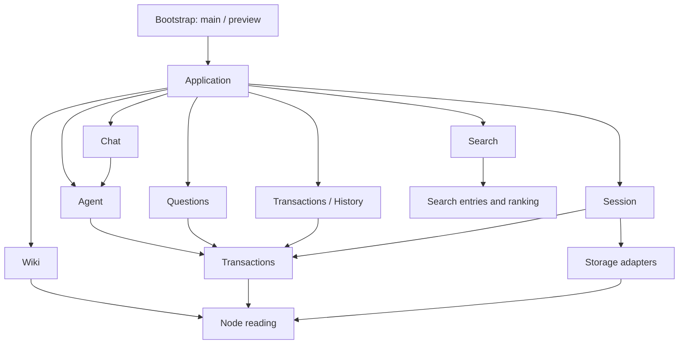
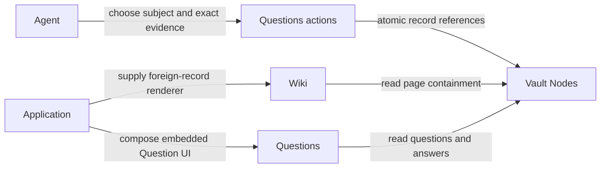

# Architecture

Application composes independently owned modules. A code dependency points from a caller to the
module whose interface it uses. A relationship stored between Nodes does not create a dependency
between their owning modules. Agent chooses those relationships; Application wires the available
record actions, readers and renderers into Agent and the views.



The graph shows the principal code dependencies. All UI owners may compose the public kit; record
modules may use Settings, Navigation and Runtime where needed. Those supporting modules never
import their consumers. No workflow imports a sibling workflow, including through a type-only
reference. Only the explicit Application composition entries and their integration tests combine
workflows. There is no extension registry, common workflow manifest or runtime feature toggle.

| Owner | Responsibility | Does not own |
|---|---|---|
| Application | Routes, shell, identities, module selection, record/tool/source composition | Record schemas or persistence |
| Agent | Execution, context discovery, grounding choices, durable tool activity, recovery, historical decoding | Wiki or Question payload interpretation |
| Chat | Conversations, messages, drafts, capture, projecting typed Agent activity into a transcript | Decoding Agent records |
| Wiki | Pages, blocks, citations, subject discovery and page presentation | Creating or answering Questions |
| Questions | Question/Answer records, action admission, atomic references, collection and embedded UI | Wiki classification or deciding which evidence to use |
| Transactions / History | Write lifetimes, acceptance/recovery state, history and guarded compensation | Producer-specific admission or undo policy |
| Session | Credentials, unlocking, adapter creation/replacement and cache lifetime | Record meaning |
| Storage | Node persistence, caches and GitHub transport | Features, credentials UI or record meaning |
| UI kit | Generic presentation, controls, focus, scrolling, responsive layout and styling | Routes, preference storage or record interpretation |
| Settings / Navigation / Search / Runtime | Preferences and settings binding / routes and commands / search interaction / scheduling and service worker | Workflow composition |

```text
app/
  main.tsx                   production bootstrap and adapter selection
  application/
    index.tsx                mounted shell and module views
    composition.ts           record sources, tools, publication rules and independent caller factories
    identities.ts            stable configured authors and atomic bootstrap
    routes.ts                application destinations
    Frame.tsx                navigation choices supplied to the kit
    AppearanceSettings.tsx   application appearance preferences
    Previews.tsx              delegated document previews
  agent/                     execution, discovery, historical reading, tools, providers and recovery
  workflows/
    chat/                    conversations, messages, capture and Chat UI
    wiki/                    pages, blocks, citations, subjects and Wiki UI
    questions/               Question/Answer actions, reading, tools and record UI
  navigation/                generic hash routes, command contracts and keyboard dispatch
  search/                    search interaction and device-local recent destinations
  settings/                  validated device preferences and module settings binding
  runtime/                   scheduling, cancellation and offline application cache
  transcription.ts           shared recording sessions and microphone lifetime
  vault/
    nodes/                   immutable model, acceptance, snapshots and memory adapter
    transactions/            scoped write lifetime, recovery and History UI/compensation
    content/                 content operations, tools and recorded action receipts
    records/                 historical source reading and shared validation values
    sources.ts               generic historical source-reading contract
    session/                 credentials, encryption and Node adapter lifetime
    storage/
      nodes/                 GitHub transaction persistence
      github-client/         shared GitHub transport
  ui/kit/                    public generic presentation and its private implementation
  preview/                   fictional adapters and examples
tools/
  architecture/              compiler-resolved dependencies, cycles and kit composition checks
  build/                     build-time dynamic-code guard and credential sealing
  preview/                   live Agent proxy and sample preview packaging/publishing
  testing/                   focused-test guards, browser runners and mutation configuration
```

`app/ui/` contains only the kit. Shared application behavior has named owners: for example,
Settings binds preferences to kit controls, Search binds results and commands to a kit overlay,
and Application selects navigation entries for the kit's layout. Module-owned record UI stays
beside the record it interprets, as required by [ADR 0006](docs/adr/0006-module-ui-and-shared-presentation.md).

## Wiki, Questions and Agent



Wiki and Questions do not call one another or consume one another's reading interfaces.
Questions accepts a generic live Node as its optional subject and exact Node addresses for source
and knowledge evidence. It validates availability, schema, attribution and atomic publication.
Agent discovers Wiki subjects and classifies evidence through owner-supplied readers composed by
Application. Agent's grounding reads remain conflict expectations until the Question is accepted.
The historical tool names `listQuestionSubjects` and `listQuestionContext` belong to Agent discovery;
Questions owns `askQuestion`, `readQuestion` and `listQuestions`.

Wiki receives a generic foreign-record renderer. Application dispatches a Question record to the
Questions-owned embedded UI and supplies its actions. Rendering a record in a Wiki page therefore
adds no Wiki-to-Questions code dependency. The stored subject and evidence references connect data;
Agent makes the choice, Questions records it, and each view reads through its own interface.

## Adding or removing a workflow

Create a folder under `app/workflows/` with its views, operations, state, adapters and tests.
Expose ordinary named functions and views, such as Questions' creation/answering actions. External
inputs are validated by the owning module. Wire views, routes and navigation in
`application/index.tsx`; wire readers, tools and publication rules in `application/composition.ts`.
Module integration tests live in `app/application/`.

Remove a workflow by deleting its folder and Application wiring. Persisted Nodes remain in the
Vault; remaining readers retain their generic unknown-record behavior. History is core Transaction
infrastructure under `vault/transactions/history/`, as decided in ADR 0009. The browser stores
application data only as Nodes. Renaming a Node means appending changed content to the same stable identity;
it does not require a separate module or rewriting identity references.

Modules define their configuration through `SettingsDefinition` in `app/settings/store.ts`: field keys,
labels, defaults, kinds, suggested choices, custom-value support and parsing. Agent owns invocation
settings, Chat owns instructions, and
OpenAI, GitHub storage and Jina own implementation-specific options and settings views. Session owns
safe credential state, replacement/restore/clear actions and their React controls; provider views
supply field meaning and consume those handles. The shared preference store validates device
preferences; `ModuleSettings` renders ordinary definitions through public kit controls. OpenAI's
settings and execution share one preference instance. Appearance uses the same definition with the
kit's theme control. Application passes `{ name, content }` entries to `SettingsMenu`. Removing a module also removes
its entry. Modules without preferences need no empty settings section.

`tools/architecture/layout.test.ts` checks compiler-resolved imports, re-exports, dynamic imports and import-type
expressions. Workflow isolation and production/fixture separation include type-only references.
Value and dynamic import cycles are rejected separately; type cycles do not imply runtime cycles.
Raw persistence and session construction remain restricted even through aliases. The checker also
prohibits imports back into Application and
keeps UI callers on public kit exports. The kit owns presentation; lower-level record and persistence
implementations cannot import views.

Record ownership includes publication. Questions owns the complete creation and answering actions:
payload validation, suggested-answer shape, direct Answer evidence, required reads and atomic
changes. Callers request those actions through Application composition. Pure preparation entries remain
available to the private Vault's translation, but do not authorize new application writes. The
Questions ownership factory is private to Application and Questions; copying valid-looking payloads,
setting a transaction kind or using the same author does not confer permission to publish.

Every Application entry supplies an enforcing NodeStore, including independent Agent and Chat
construction. Questions privately retains its action-produced work through entered publication and
exact save retries. A generic publication rule runs against authoritative history at acceptance in
both memory and GitHub adapters. Persistence owns structural integrity; Questions owns interpretation
and admission of Question, Answer and task Relationship changes. An unauthorized change rejects the
whole Transaction, including when bundled with initial Chat and Agent records. Historical loading
and identical already-accepted retries retain their existing behavior.

Raw node adapters and acceptance/loading functions are private to bootstrap, persistence and
historical fixtures. Session hooks exposing raw handles remain with Vault session assembly and
Application; preview fixtures cannot be imported by production callers. The compiler-backed layout policy
checks these resolved origins through aliases and re-exports, while permitting ordinary node reads
and errors. Keeping those handles out of task
code prevents a new producer from bypassing the Application-supplied interface. This deepens the
Questions module at its existing seam: callers gain leverage from two actions, and validation,
construction, ownership and tests retain locality within Questions.

## Node-only application data

Session opens one Node adapter and exposes managed Transaction reading/writing. It admits the
application after a cached snapshot or successful remote refresh, including an empty vault.
Cold-load errors stay on the opening screen; cached data stays readable through refresh failures
or offline use. GitHub credential replacement prepares and validates only the Node adapter before
activating it. Search receives Wiki entries and starts empty while that reading is loading.

The browser has no file backend, file staging, Markdown fallback or schema startup gate. Chat
submits node messages directly after admission; pending node persistence still uses its existing
recovery actions. Shared search entries/ranking live in Search, safe URLs in Navigation, and
Markdown rendering in Chat.

Source translation and enrichment belong to the private Vault under ADR 0007.

## Conversation lifetime

Application creates one node-backed Chat interaction above route selection, scoped to its Vault
session. The page, pane, chooser, routes and commands request tasks through that same owner.
Chat owns conversational admission, drafts, selection, prompts, unread acknowledgement and recovery
presentation; closing a view preserves task state. Accepted history is read without executing Agent.

Application supplies capabilities, navigation and the shared Transcription. Same-session updates
apply to later explicit work; admitted execution and recording retain their original providers.
Session replacement creates fresh owners. Chat destroys only its owned resources, invalidating late
callbacks while entered acceptance and effects retain their independent obligations. Injected
Transcription may also serve Questions, so Chat never disposes that borrowed module.

Chat and Agent prepare their initial records independently, composed into one Transaction before
model/tool effects. Chat's append queue covers preparation and initial acceptance rather than the
whole execution. Agent owns run/tool ordering and outcome recovery; tools own domain admission and
publication. The kit presents supplied state and actions without acquiring those lifetimes.

See the [Chat interface and lifetime](app/workflows/chat/README.md),
[Agent execution and recovery](app/agent/README.md) and shared recording owner in
[transcription.ts](app/transcription.ts) for task contracts, capture revisions and recovery details.

## UI kit

The implemented ownership decision is [ADR 0006](docs/adr/0006-module-ui-and-shared-presentation.md):
modules own record-specific UI and typed reading projections; the kit owns generic presentation and
shared compositions. Supporting panes share one geometry, scrolling, dismissal, focus and responsive
policy. Callers supply content, actions and requested visibility.

The [public kit interface](app/ui/kit/index.ts) and [kit guide](app/ui/kit/README.md) own supported
components, detailed presentation contracts and paired catalogue examples. Public components accept
no styling props; Tailwind scans only the kit. Application, Settings, Navigation, Search and workflow
views compose those exports. Semantic content renderers have narrow permissions for text markup;
they cannot implement layout, controls, viewport policy or private presentation-library mechanics.

Search belongs to [app/search/Search.tsx](app/search/Search.tsx). Its container owns query, ranking,
recent destinations and navigation/command/ask actions; SearchView accepts resolved entries and
explicit actions. CommandOverlay supplies generic responsive geometry and focus/dismissal mechanics.
The kit imports neither Search nor other application consumers.

The compiler-backed [layout policy](tools/architecture/layout.test.ts) checks dependency direction,
workflow isolation, public kit imports and presentation ownership. Exact declaration roles in
[composition.ts](app/ui/kit/composition.ts) distinguish DOM/library mechanics from checked
compositions. [Composition checks](tools/architecture/composition.test.ts) follow reachable private
helpers through imports, aliases and re-exports, stopping at approved building blocks; they also
verify the catalogue's Built from metadata. [Catalogue checks](tools/architecture/catalogue.test.ts)
require live examples for public exports. Internal extraction adds no public API obligation.

## Browser and deployment

Production bootstrap selects GitHub persistence and a plaintext rebuildable device cache. No
browser source depends on Node.js; the toolchain uses Node 24. Deployment seals credentials into
secrets.json relative to the published app root. Notes stay in the private Vault.

Session owns credential unlocking, encrypted device overrides, adapter replacement and sign-out.
Replacing GitHub credentials prepares and refreshes a candidate adapter before activation; failure
preserves the active session. A successful replacement keeps the stable session identity and open
conversation. See the [Vault guide](app/vault/README.md) and
[credential decision](docs/adr/0008-device-credential-overrides.md) for the current contracts.

The alternate bootstrap in app/preview supplies fictional records, memory persistence and scripted
providers to the same Application. Its tab journal reopens accepted history without executing it.
Local live preview proxies configured providers through Vite while tools write only to sample
storage; published previews use scripted providers and carry no credentials or service worker.
Fictional evidence uses module-owned reading and rendering, with independent bounded examples.
Compiler-resolved production reachability rejects preview, catalogue and tooling dependencies,
including type-only and dynamic imports.

The [preview guide](docs/agents/preview.md) owns comparisons, review and promotion;
the [testing guide](docs/agents/testing.md) owns focused checks, devices and commit verification.
[Publishing](README.md#publishing) documents installation configuration and artifact packaging.

## Node storage

NodeStore provides generic snapshot and exact-version reading plus atomic append writes. Storage
owns structural integrity and acceptance; producers own payload meaning and admission. Session
owns adapter/cache lifetime and exposes managed Transactions to Application and its callers.
The [Vault guide](app/vault/README.md) owns persisted layouts, retry, ordering, offline and history
limits; [ADR 0003](docs/adr/0003-github-node-persistence.md) records GitHub acceptance authority.

History interprets accepted Transactions and supplies guarded compensation. Application composes
producer-owned preservation policies into History; History never imports those workflows.
Chat reads Agent activity through Agent's historical reading interface, keeping transcript ordering
and message projection with Chat. Reading records never depends on live execution ownership.

## Wiki record ownership

Wiki owns page/block/citation payloads, containment, text grammar, source eligibility and evidence
validation. Only page records enter its collections and page routes. Content, Chat, Agent and retained
records remain independent sources interpreted by their owners through vault/sources.ts;
Application explicitly composes those readers and foreign-record renderers.

The private Vault owns source reading, translation, enrichment and review policy. It pins Vaulter
as a Git submodule and imports existing owner preparation and validation entries. Advancing that
pin requires adapting the consumer rather than preserving a separate migration SDK, as decided in
[ADR 0007](docs/adr/0007-vault-owned-translation.md). Published exact evidence remains readable as
future payloads evolve through owner historical decoders and appended upgrades.

Production reads historical source text through retainedRecordSources. Shared validation values
support current Wiki, Questions and historical Chat records. Validation used solely to translate
unimplemented record kinds belongs with the private Vault tooling.
See [Wiki ingestion](app/workflows/wiki/README.md) for preparation, exact-baseline validation and
links to private Vault operations.

## Chat record UI and shared presentation

Chat owns message roles, transcript ordering, conversation rows and conversational task UI.
Agent owns run/tool interpretation; Content and Questions own action labels and receipt rendering.
Application supplies those adapters to Chat. Unknown actions retain raw readable evidence;
rendering neither creates executable tools nor publishes records. Record views accept typed data
and explicit actions independently of a live store or execution controller.

Application supplies page routes and supporting-task visibility. Chat composes public reading,
feed, dock and supporting-pane presentation; Wiki and its embedded Question card use the same
shared pane and text-entry policies. TextBox owns keyboard/form/focus and inset actions while
workflow owners retain drafts, capture associations, validation, acceptance and persistence.

The [Chat guide](app/workflows/chat/README.md) owns detailed projections and lifetime contracts;
the [kit guide](app/ui/kit/README.md) owns presentation APIs. Semantic text conversion remains a
narrow renderer permission, with prose typography and code scrolling supplied by the kit.
