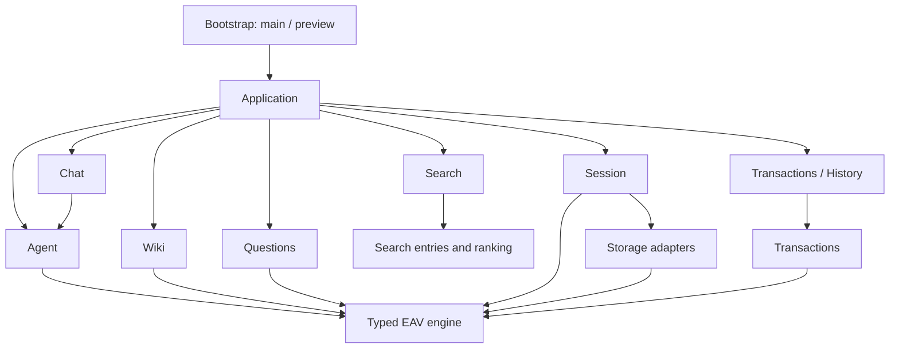
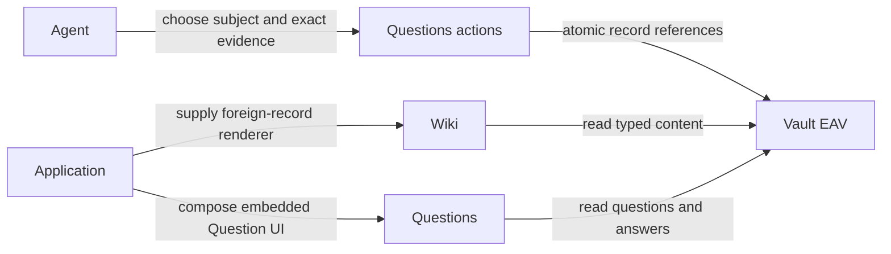

# Architecture

Application composes independently owned modules. A code dependency points from a caller to the
module whose interface it uses. A relationship stored between entities does not create a dependency
between their owning modules. Agent chooses those relationships; Application wires the available
record actions, readers and renderers into Agent and the views.



The graph shows the principal code dependencies. All UI owners may compose the public kit; record
modules may use Settings, Navigation and Runtime where needed. Those supporting modules never
import their consumers. No workflow imports a sibling workflow, including through a type-only
reference. Calendar and Map keep record behavior behind their public entries and Application composition;
other owners may consume their shared value types and parsers without acquiring their record behavior. Only the explicit Application composition entries and their integration tests combine
workflows. There is no extension registry, common workflow manifest or runtime feature toggle.

| Owner | Responsibility | Does not own |
|---|---|---|
| Application | Routes, shell, identities, module selection, record/tool/source composition | Record schemas or persistence |
| Calendar | TimeValue conventions, Events, annual dates and calendar reading/presentation | Subject meaning, reminders or automatic time-based state changes |
| Map | Latitude/longitude values, required subject associations and Map record UI | Subject records, coordinate conversion or base-map mechanics |
| Agent | Execution, context discovery, grounding choices, durable tool activity, recovery, historical decoding | Wiki or Question payload interpretation |
| Chat | Continuous conversation, messages, drafts, capture, projecting typed Agent activity into a transcript | Decoding Agent records |
| Wiki | Pages, blocks, citations, subject discovery and page presentation | Creating or answering Questions |
| Graph | Topics, memberships, typed relationships, historical endpoint interpretation and exploration UI | Wiki content or presentation, persistence |
| Questions | Question/Answer records, action admission, atomic references, collection and embedded UI | Wiki classification or deciding which evidence to use |
| Transactions / History | Single-journal history and historical change presentation | Producer-specific admission or compensation policy |
| Session | Credentials, unlocking, adapter creation/replacement and cache lifetime | Record meaning |
| Storage | EAV journal persistence, caches and GitHub transport | Features, credentials UI or record meaning |
| UI kit | Generic presentation, controls, focus, scrolling, responsive layout and styling | Routes, preference storage or record interpretation |
| Settings / Navigation / Search / Runtime | Preferences and settings binding / routes and commands / search interaction / scheduling and service worker | Workflow composition |

```text
app/
  main.tsx                   production bootstrap and adapter selection
  application/
    index.tsx                mounted shell and module views
    composition.ts           record sources, tools, publication rules and independent caller factories
    identities.ts            stable configured authors and atomic bootstrap
    routes.ts                application destinations
    Frame.tsx                navigation choices supplied to the kit
    AppearanceSettings.tsx   application appearance preferences
    Previews.tsx              delegated document previews
  agent/                     execution, discovery, historical reading, tools, providers and recovery
  calendar/                  TimeValue, Events, annual dates and Calendar UI
  map/                       geographic coordinate values and attached coordinate records
  workflows/
    chat/                    conversations, messages, capture and Chat UI
    wiki/                    pages, blocks, citations, subjects and Wiki UI
    graph/                   relationships, vocabulary, snapshot traversal and live queries
    questions/               Question/Answer actions, reading, tools and record UI
  navigation/                generic hash routes, command contracts and keyboard dispatch
  search/                    search interaction and device-local recent destinations
  settings/                  validated device preferences and module settings binding
  runtime/                   scheduling, cancellation and offline application cache
  transcription.ts           shared recording sessions and microphone lifetime
  vault/
    eav/                     typed engine, atomic transactions, snapshots and memory storage
    transactions/            core History reading and UI
    records/                 shared Actor records
    sources/                 retained SourceDocuments
    evidence/                historical selections, Reviews and passages
    session/                 credentials, encryption and EAV journal lifetime
    storage/
      eav/                   GitHub transaction persistence
      github-client/         shared GitHub transport
  ui/kit/                    public generic presentation and its private implementation
  preview/                   fictional adapters and examples
tools/
  architecture/              compiler-resolved dependencies, cycles and kit composition checks
  build/                     build-time dynamic-code guard and credential sealing
  preview/                   live Agent proxy and sample preview packaging/publishing
  testing/                   focused-test guards, browser runners and mutation configuration
```

`app/ui/` contains only the kit. Shared application behavior has named owners: for example,
Settings binds preferences to kit controls, Search binds results and commands to a kit overlay,
and Application selects navigation entries for the kit's layout. Module-owned record UI stays
beside the record it interprets, as required by [ADR 0006](docs/adr/0006-module-ui-and-shared-presentation.md).

## Import paths

Use `@/` (the `app/` root) for imports outside the current directory, including tests,
re-exports and dynamic imports. For example, use `@/ui/kit/index.ts` instead of
`../../../ui/kit/index.ts`. Keep `./` for neighboring files so local implementation
files can move together. Biome enforces this convention in app source.

Import an owner's public entry when one exists, such as `@/vault/eav/index.ts` or
`@/ui/kit/index.ts`. Aliases keep imports stable when a caller moves; public entries
keep callers stable when private implementation files move. Moving a public entry
still requires updating its callers. The compiler-resolved ownership checks apply
to both relative paths and aliases.

TypeScript, Vite, Vitest and the standalone kit resolve `@/` to `app/`; Playwright
uses the TypeScript paths. Node tools and configuration files retain explicit relative
imports because Node's native TypeScript execution does not resolve TypeScript aliases.

## Wiki, Questions and Agent



Wiki and Questions do not call one another or consume one another's reading interfaces.
Wiki also has no direct dependency on Graph. Application supplies a snapshot-scoped related-content
reading that delegates classification, Relationship labels and Query evaluation to Graph. Wiki
supplies page candidates and renders the results; Graph interprets its own organization and relationships.
Questions accepts accepted historical EAV addresses for subjects, sources, knowledge and reviews.
It validates availability, schema, attribution and atomic publication. Application supplies EAV
source and subject discovery to Agent. Questions owns `askQuestion`, `readQuestion` and
`listQuestions`; its public model uses EAV evidence and attribution throughout.

Wiki receives a generic foreign-record renderer. Application dispatches a Question record to the
Questions-owned embedded UI and supplies its actions. Rendering a record in a Wiki page therefore
adds no Wiki-to-Questions code dependency. The stored subject and evidence references connect data;
Agent makes the choice, Questions records it, and each view reads through its own interface.

## Adding or removing a workflow

Create a folder under `app/workflows/` with its views, operations, state, adapters and tests.
Expose ordinary named functions and views, such as Questions' creation/answering actions. External
inputs are validated by the owning module. Wire views, routes and navigation in
`application/index.tsx`; wire readers, tools and publication rules in `application/composition.ts`.
Module integration tests live in `app/application/`.

Remove a workflow by deleting its folder and Application wiring. Accepted history remains immutable;
registered schema removal requires explicit evolution. History is core infrastructure under
`vault/transactions/history/`. Content changes append transactions to stable entity identities.

Modules define their configuration through `SettingsDefinition` in `app/settings/store.ts`: field keys,
labels, defaults, kinds, suggested choices, custom-value support and parsing. Agent owns invocation
settings, Chat owns instructions, and
OpenAI and GitHub storage own implementation-specific options and settings views. Session owns
safe credential state, replacement/restore/clear actions and their React controls; provider views
supply field meaning and consume those handles. The shared preference store validates device
preferences; `ModuleSettings` renders ordinary definitions through public kit controls. OpenAI's
settings and execution share one preference instance. Appearance uses the same definition with the
kit's theme control. Application passes `{ name, content }` entries to `SettingsMenu`. Removing a module also removes
its entry. Modules without preferences need no empty settings section.

`tools/architecture/layout.test.ts` checks compiler-resolved imports, re-exports, dynamic imports and import-type
expressions. Workflow isolation and production/fixture separation include type-only references.
Value and dynamic import cycles are rejected separately; type cycles do not imply runtime cycles.
Raw persistence and session construction remain restricted even through aliases. The checker also
prohibits imports back into Application and
keeps UI callers on public kit exports. The kit owns presentation; lower-level record and persistence
implementations cannot import views.

Questions owns complete creation and answering actions: input validation, proposals, direct Answer
evidence and atomic changes. Application supplies trusted actor/origin context. EAV acceptance
rejects stale drafts and competing answers; uncertain saves retain the exact publication retry.

Persistence construction stays with bootstrap, Vault session assembly and storage. Workflows receive
typed owner interfaces; production callers cannot import preview fixtures. Compiler-backed ownership
checks follow resolved origins through aliases and re-exports. Validation and domain action admission
remain local to owners.

## EAV application data

Session opens one EAV journal and admits the application once accepted cached or remote state is
available, including an empty Vault. Cached state remains readable during refresh failures. Credential
replacement validates a candidate adapter before activation. Search receives Wiki entries and remains
empty until its reader is ready. Private source translation and enrichment stay with Vault tooling
under ADR 0007.

## Conversation lifetime

Application creates one continuous Chat interaction above route selection, scoped to its Vault
session. The page, pane, routes and commands request tasks through that same owner.
Chat owns conversational admission, drafts, timeline navigation, prompts, unread acknowledgement and recovery
presentation; closing a view preserves task state. Accepted history is read without executing Agent.

Application supplies capabilities, navigation and the shared Transcription. Same-session updates
apply to later explicit work; admitted execution and recording retain their original providers.
Session replacement creates fresh owners. Chat destroys only its owned resources, invalidating late
callbacks while entered acceptance and effects retain their independent obligations. Injected
Transcription may also serve Questions, so Chat never disposes that borrowed module.

Chat and Agent prepare their initial records independently, composed into one Transaction before
model/tool effects. Chat's append queue covers preparation and initial acceptance rather than the
whole execution. Agent owns run/tool ordering and outcome recovery; tools own domain admission and
publication. The kit presents supplied state and actions without acquiring those lifetimes.

See the [Chat interface and lifetime](app/workflows/chat/README.md),
[Agent execution and recovery](app/agent/README.md) and shared recording owner in
[transcription.ts](app/transcription.ts) for task contracts, capture revisions and recovery details.

## UI kit

The implemented ownership decision is [ADR 0006](docs/adr/0006-module-ui-and-shared-presentation.md):
modules own record-specific UI and typed reading projections; the kit owns generic presentation and
shared compositions. Supporting panes share one geometry, scrolling, dismissal, focus and responsive
policy. Callers supply content, actions and requested visibility.

The [public kit interface](app/ui/kit/index.ts) and [kit guide](app/ui/kit/README.md) own supported
components, detailed presentation contracts and paired catalogue examples. Public components accept
no styling props; Tailwind scans only the kit. Application, Settings, Navigation, Search and workflow
views compose those exports. Semantic content renderers have narrow permissions for text markup;
they cannot implement layout, controls, viewport policy or private presentation-library mechanics.

Search belongs to [app/search/Search.tsx](app/search/Search.tsx). Its container owns query, ranking,
recent destinations and navigation/command/ask actions; SearchView accepts resolved entries and
explicit actions. CommandOverlay supplies generic responsive geometry and focus/dismissal mechanics.
The kit imports neither Search nor other application consumers.

The compiler-backed [layout policy](tools/architecture/layout.test.ts) checks dependency direction,
workflow isolation, public kit imports and presentation ownership. Exact declaration roles in
[composition.ts](app/ui/kit/composition.ts) distinguish DOM/library mechanics from checked
compositions. [Composition checks](tools/architecture/composition.test.ts) follow reachable private
helpers through imports, aliases and re-exports, stopping at approved building blocks; they also
verify the catalogue's Built from metadata. [Catalogue checks](tools/architecture/catalogue.test.ts)
require live examples for public exports. Internal extraction adds no public API obligation.

## Browser and deployment

Production bootstrap selects GitHub persistence and a plaintext rebuildable device cache. No
browser source depends on Node.js; the toolchain uses Node 24. Deployment seals credentials into
secrets.json relative to the published app root. Notes stay in the private Vault.

Session owns credential unlocking, encrypted device overrides, adapter replacement and sign-out.
Replacing GitHub credentials prepares and refreshes a candidate adapter before activation; failure
preserves the active session. A successful replacement keeps the stable session identity and open
conversation. See the [Vault guide](app/vault/README.md) and
[credential decision](docs/adr/0008-device-credential-overrides.md) for the current contracts.

The alternate bootstrap in app/preview supplies fictional records, memory persistence and scripted
providers to the same Application. Its tab journal reopens accepted history without executing it.
Local live preview proxies configured providers through Vite while tools write only to sample
storage; published previews use scripted providers and carry no credentials or service worker.
Fictional evidence uses module-owned reading and rendering, with independent bounded examples.
Compiler-resolved production reachability rejects preview, catalogue and tooling dependencies,
including type-only and dynamic imports.

The [preview guide](docs/agents/preview.md) owns comparisons, review and promotion;
the [testing guide](docs/agents/testing.md) owns focused checks, devices and commit verification.
[Publishing](README.md#publishing) documents installation configuration and artifact packaging.

## EAV storage and History

The typed engine provides opaque entity identity, atomic transactions, queryable snapshots and
validated historical references. Storage owns acceptance and immutable journal replay; producers own
domain meaning and admission. Session owns the single adapter/cache lifetime. The [Vault guide](app/vault/README.md)
documents retry, offline reading and history limits; [ADR 0003](docs/adr/0003-github-eav-persistence.md)
records remote acceptance authority and [ADR 0014](docs/adr/0014-eav-only-vault.md) records complete adoption.

History reads accepted transactions and historical entity changes without importing workflows or
resuming execution. It is a core application action alongside Settings. Its drawer retains the
underlying page and draft and uses the kit's grouped surfaces, expandable rows, metadata and diffs.
Direct History URLs enter that same drawer over Chat. Chat reads canonical Agent activity through
Agent's owner interface and retains transcript ordering and message projection.

## Wiki record ownership

Wiki owns typed pages, content, appearances, containment, text grammar, source eligibility and selected
assertion evidence. Captured sources, Chat, Agent and Questions keep independent owner records.
Application explicitly composes source projections and foreign-record renderers; Wiki consumes the
supplied interfaces without importing sibling workflows.

The private Vault pins Vaulter and targets current typed owner interfaces for translation and reviewed
publication. Advancing that pin requires adapting the consumer under [ADR 0007](docs/adr/0007-vault-owned-translation.md).
Historical EAV references preserve accepted source snapshots. Application opening performs no source
translation or history reset. See the [Wiki guide](app/workflows/wiki/README.md).

## Chat record UI and shared presentation

Chat owns message roles, transcript ordering, conversation rows and conversational task UI.
Agent owns run/tool interpretation; Wiki, Graph and Questions own action labels and receipt rendering.
Application supplies those adapters to Chat. Unknown actions retain raw readable evidence;
rendering neither creates executable tools nor publishes records. Record views accept typed data
and explicit actions independently of a live store or execution controller.

Application supplies page routes and supporting-task visibility. Chat composes public reading,
feed, dock and supporting-pane presentation; Wiki and its embedded Question card use the same
shared pane and text-entry policies. TextBox owns keyboard/form/focus and inset actions while
workflow owners retain drafts, capture associations, validation, acceptance and persistence.

The [Chat guide](app/workflows/chat/README.md) owns detailed projections and lifetime contracts;
the [kit guide](app/ui/kit/README.md) owns presentation APIs. Semantic text conversion remains a
narrow renderer permission, with prose typography and code scrolling supplied by the kit.

## Current-model cleanup

Chat exposes one Conversation and a reload task, with no selectable-chat mode, caller-supplied Conversation identity, saved-chat collection,
pagination or creation action. Agent's `reading.ts` owns recorded Model step decoding and live Tool
execution projections; Chat receives interpreted activity and retains Exchange ordering. Only the
current `ai-sdk-model-messages-v7` format is decoded. Absent responses on unfinished requests and
opaque external execution are current behavior, not compatibility with retired formats.

Actor records own shared binding lookup, kind validation and atomic creation. Callers keep configured
account keys, trusted author selection, transaction admission and exact-save recovery. Binding creation
runs inside the caller's transaction and never retries it independently.

Retired models do not constrain the current schema or reading interface. The obsolete `chat.migration`
definition is removed; journals requiring retired definitions need separate source-vault conversion
before opening. Current accepted Transactions, historical references and execution-neutral reads remain
part of the product. Application opening performs no conversion or history reset.
