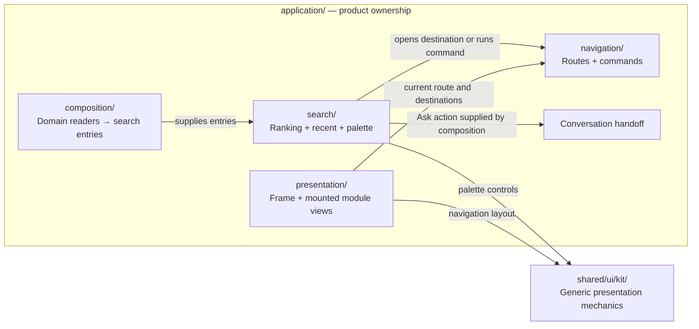
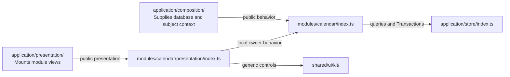
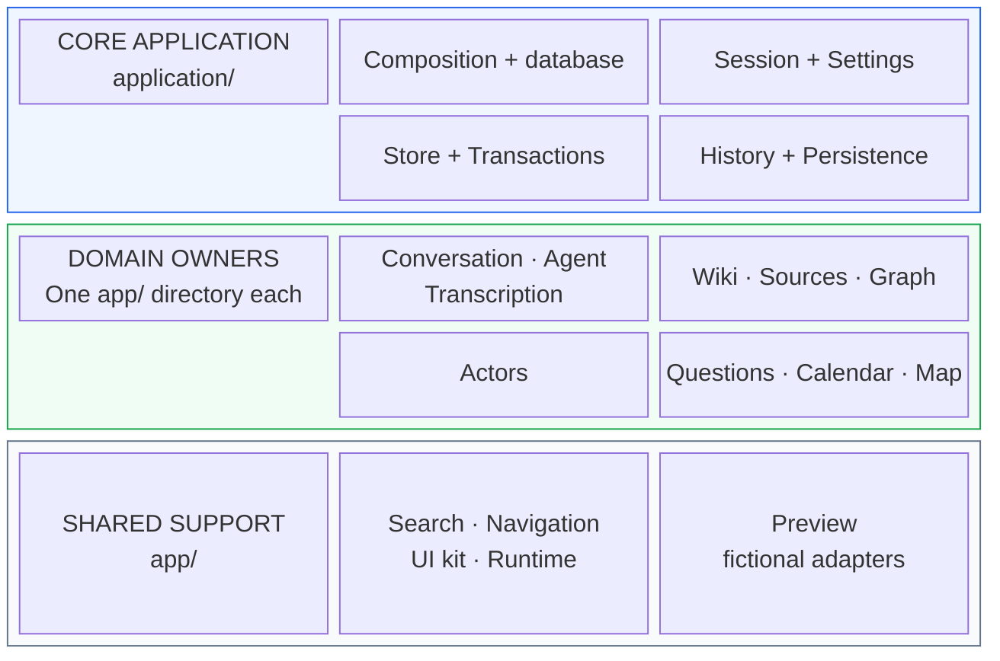
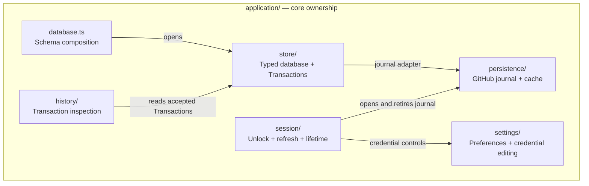
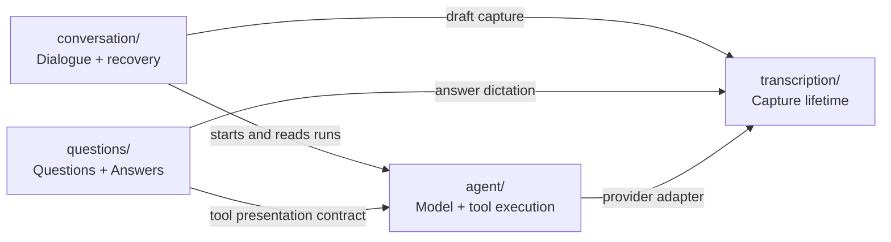
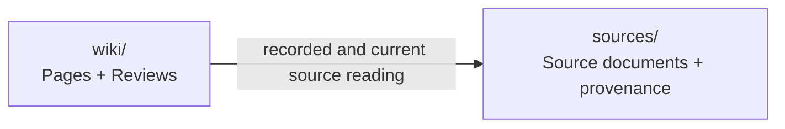
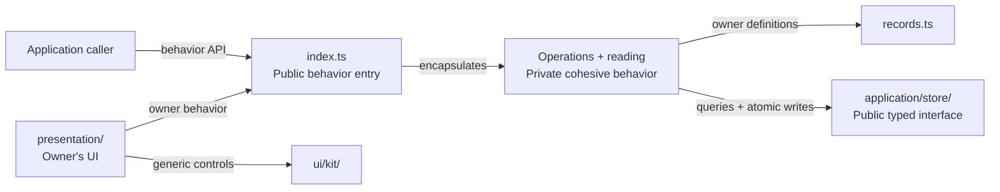

# Project layout and ownership

Start in the domain that owns the behavior. Its retained definitions, operations, reading and
presentation live together. `index.ts` is the behavior entry; `presentation/index.tsx` (or `.ts`)
is the presentation entry when one exists. Implementation files stay private to their owner.

```text
app/
├── application/                 Core application
│   ├── database.ts              Compose owner definitions; open one typed database
│   ├── composition.ts           Compose domain behavior and trusted context
│   ├── store/                   Entities, Transactions, Snapshots, history, exact save retry
│   ├── persistence/             GitHub journal transport, cache and connection preferences
│   ├── session/                 Credentials, unlock, refresh and journal retirement
│   ├── settings/                Shared preference persistence and credential presentation
│   ├── history/                 Transaction inspection and History drawer
│   └── index.tsx                Navigation, global presentation and mounted owner lifetime
├── actors/                      Attribution identity and atomic account binding
├── sources/                     Source documents and recorded/current source reading
├── conversation/                Conversation, Exchanges, Messages, context and recovery
│   └── presentation/            Chat page/pane, dialogue timeline and text rendering
├── agent/                       Agent runs, Model steps, Tool executions, text/voice effects
│   ├── openai/                  Provider transport adapters and configuration
│   └── presentation/            Agent settings and recorded/live activity views
├── wiki/                        Pages, content, Appearance and Page references
│   ├── reviews/                 Review records, selection validation and admission
│   └── presentation/            Wiki pages, support views and semantic rendering
├── graph/                       Topics, membership, Relationships and vocabulary
│   └── presentation/            Graph page and exploration
├── questions/                   Questions, Answers, collection lifetime and save recovery
│   └── presentation/            Questions page, embedded Questions and tool results
├── calendar/                    Time values, Events and recurring annual dates
│   └── presentation/            Calendar page and timeline
├── map/                         Coordinate records and geographic values
│   └── presentation/            Map page
├── transcription/               Capture lifetime and transport contract
├── search/                      Ranking, recent entries and search interaction
│   └── Search.tsx               Search presentation (not yet in presentation/)
├── navigation/                  Routes, commands and keyboard navigation
├── ui/kit/                      Generic presentation and browser mechanics
├── runtime/                     Small independent runtime utilities
└── preview/                     Fictional records and scripted transport adapters
```

## Proposed next structure: explicit module homes

The tree above describes the current code. This target makes module homes explicit and applies
the same presentation convention to domain modules and core-owned modules. It has not yet been
implemented. A module contains its behavior and presentation together; `modules/` contains the
domain modules, and `application/` contains the shell, composition and core-owned modules.

```text
app/
├── main.tsx
├── application/                 Core application owner
│   ├── composition/             Database registry, domain joins and production wiring
│   ├── presentation/            Frame, routes, navigation and global settings composition
│   ├── navigation/              Routes, destinations, commands and global key bindings
│   ├── search/                  Global search, ranking and recent destinations
│   │   └── presentation/        Search palette and Agent handoff
│   ├── runtime/                 Startup and offline application asset caching
│   ├── store/                   Core module: typed database and Transactions
│   ├── persistence/             Core module: journal transport and cache
│   │   └── presentation/        Connection preferences
│   ├── session/                 Core module: unlock, refresh and lifetime
│   │   └── presentation/        Gate and session controls
│   ├── settings/                Core module: preference persistence and credential editing
│   │   └── presentation/        Shared setting fields and credential controls
│   └── history/                 Core module: accepted Transaction reading
│       └── presentation/        History drawer and list
├── modules/                     Domain modules; each directory is an owner
│   ├── actors/                  Behavior and records; no standalone presentation today
│   ├── sources/                 Behavior and records; no standalone presentation today
│   ├── transcription/           Capture behavior; presentation belongs to capture callers
│   ├── conversation/
│   │   └── presentation/        Chat, timeline, rendering and Conversation settings
│   ├── agent/
│   │   ├── openai/              Provider adapter and configuration
│   │   └── presentation/        Agent settings and activity/tool views
│   ├── wiki/
│   │   ├── reviews/             Private cohesive Review behavior
│   │   └── presentation/        Pages, support views and rendering
│   ├── graph/
│   │   └── presentation/        Graph exploration
│   ├── questions/
│   │   └── presentation/        Questions, Answers and tool results
│   ├── calendar/
│   │   └── presentation/        Calendar page and timeline
│   └── map/
│       └── presentation/        Map page
├── shared/                      Reusable support; no domain record interpretation
│   ├── ui/kit/                  Generic controls, layouts, focus and interaction mechanics
│   ├── browser/                 Safe URL handling shared by content renderers
│   └── async/                   Independent queue and cancellation utilities
└── preview/                     Fictional composition using public module entries
```

### Application versus Shared

Application owns product-wide behavior, core data infrastructure and composition. Shared owns
reusable mechanics whose interface can be described without naming an application workflow.
Use by several domains does not by itself make something Shared. Both Application and domain
modules may use Shared; Shared imports neither Application nor domain owners.

| Capability | Target home | Ownership |
| --- | --- | --- |
| Global Search | `application/search/` | Entry contract, ranking policy, recent destinations and search/command/Agent interaction; Application composition assembles entries from domain readers |
| Application Navigation | `application/navigation/` | Route contracts, destination definitions, commands, URL transitions and global shortcuts; module-specific actions remain with their module |
| UI kit | `shared/ui/kit/` | Generic rendering, responsive layout, theme mechanics, focus, scrolling, keyboard list movement, overlays and controls; callers supply content and actions |
| Application frame | `application/presentation/` | Which destinations and actions appear, their labels, current route and module mounting; the kit renders supplied navigation |
| Settings | `application/settings/` | Shared preference persistence and credential editing; each domain owns its setting meanings and fields; Application composes the global Settings screen |
| Theme preferences | `application/settings/` | The selected preference and its persistence; kit theme controls and visual application consume the supplied preference |
| Offline application runtime | `application/runtime/` | Startup, service-worker registration and caching rules for application assets and sealed credentials |
| Async mechanics | `shared/async/` | In-process serialization, cancellation and reporting of unobserved work; no journal or domain policy |
| Safe browser URLs | `shared/browser/` | URL scheme validation usable by multiple content renderers; navigation destinations remain Application-owned |
| Preview | `preview/` | Fictional Application composition and adapters, outside production ownership |

Search is a core-owned module with behavior and presentation, just like History and Settings.
Its current ranking prioritizes Topics and Notes, and its palette combines commands, recent
destinations and an Agent handoff. These are product decisions. The kit owns the generic palette
controls; Search owns how those controls become the product's Search experience.

Navigation has the same split: Application chooses destinations, routes and actions; the kit
renders a sidebar, compact navigation and generic keyboard interactions. Keep routing behavior
together under Application initially. Extract a generic router only if another real caller needs
an independent interface. Existing module-local search stays inside its owning module.



These are target placements; the current source paths remain in the first tree.

### Module convention

Every module has one home and a named public behavior entry. A module with presentation exposes
`presentation/index.ts` (or `.tsx`), consistently. Application mounts that presentation and supplies
cross-domain context. A module owns its page, settings fields, embedded views and tool-result views,
even when those views appear inside another module's screen.

```text
<module>/
├── index.ts                     Public behavior interface
├── records.ts                   Retained definitions, when the module owns records
├── operations.ts                Writes and admission, when needed
├── reading.ts                   Reads and projections, when needed
├── configuration.ts             Configuration meaning and validation, when needed
├── <named-behavior>/            Private cohesive behavior, when it merits a folder
└── presentation/                When the module has UI
    ├── index.ts                 Public presentation interface
    ├── <Module>Page.tsx          Page, when it has one
    ├── Settings.tsx             Owner-specific settings fields, when needed
    └── ...                      Owner views, hooks and rendering
```

The public entries are consistent; implementation names follow the domain's vocabulary.
Small modules do not need empty folders or placeholder files. Tests live beside the behavior or
presentation they verify. Internal owner code can use relative imports; outside callers cross
public entries. React rendering and presentation hooks live in `presentation/`; admission,
subscriptions and recovery that must also work without React remain in behavior.



This Calendar example applies to every module with UI. Core-owned modules use the same convention
under `application/`. Cross-domain semantic dependencies stay explicit as described below;
the directory move does not replace them with a global module registry.

### Framework inspiration

| Source | Convention to adopt here | Adaptation for this project |
| --- | --- | --- |
| [Feature-Sliced Design](https://feature-sliced.design/docs/reference/slices-segments) | Explicit module directories, private implementation and public entries | Keep each domain's records, behavior and presentation together; preserve the existing semantic dependencies between domains |
| [Angular style guide](https://angular.dev/style-guide) | Organize by feature area and keep related files together | Apply that organization to React; a page and its behavior live in the same owning module |
| [Hexagonal architecture](https://alistair.cockburn.us/hexagonal-architecture) | Separate behavior from presentation and external adapters | Keep journal/model transports replaceable and behavior usable without React; introduce adapter folders where concrete variation exists |

The recommended next pass is to establish these root directories, normalize presentation entries,
move core presentation beside its owning behavior, and update import enforcement. This changes
where modules live and how callers find them; it does not require a framework migration.

## Ownership and dependencies

Read these views in order: ownership, core services, domain connections, then Application joins.
Boxes show owners or public capabilities. In dependency diagrams, `A → B` means **A uses B**;
edge labels say what it uses. The diagrams show architectural relationships, not every import.

### 1. Ownership: where to start

The three rows are directory groups. This view has no dependency arrows. Grouping related domains
helps navigation; it does not introduce another owner above them.



### 2. Core services: one shared database

Settings, the data store, Transactions and History belong to the core application.
Domain owners define their records; `application/database.ts` combines those definitions.
The store engine remains independent of those domain schemas.



Retained-record owners use the core store's public interface for queries and atomic writes.
This is a common dependency across those owners, so it is shown once here. Domain-specific
settings fields keep their meanings in their domain; core Settings owns persistence and editing.

### 3. Domain connections: execution and knowledge

These connections carry domain meaning. They belong in the consuming owner.
Conversation owns dialogue; Agent owns execution, including runs that have no Conversation.





Conversation, Agent, Wiki and Questions use `actors/` directly for shared attribution.
Application supplies trusted author references to Calendar and Map. Producers that bind an account
do so inside their own Transaction. These shared relationships are stated once to keep the diagrams legible.
Graph, Calendar and Map receive foreign-record descriptions from Application.

### 4. Application joins: where domains meet

Application supplies context and adapters through public owner interfaces. These combinations
are owned by `application/`; they do not make either domain responsible for the other's behavior.

| Application composition | Owners connected | What Application supplies |
| --- | --- | --- |
| Wiki Topics | Wiki + Graph | Topic membership for Wiki pages |
| Subject calendars | Wiki + Calendar | Subject descriptions and calendar context |
| Map choices | Map + Wiki, Calendar, Questions, Sources | Foreign record choices and descriptions |
| Question context | Questions + selected foreign records | Selected context and trusted user identity |
| Search entries | Search + searchable domain owners | Entries produced from each owner's records |
| Agent tools | Agent + tool-owning domains | Tool adapters and trusted execution context |

### 5. Inside one domain: keep the whole concept together

This is the reading path for a typical domain; specific filenames reflect its vocabulary.
Application callers use the public entries, and presentation delegates behavior to its owner.



### Ownership reference

| Module | Owns | Caller supplies |
| --- | --- | --- |
| Core store | Typed records, identity, queries, atomic Transactions, recorded history and exact publication retry | Composed owner definitions; persistence adapter |
| Core session | Unlock, credential changes, cache readiness, refresh and journal retirement | Production or fictional persistence factory |
| Core Settings | Preference persistence and safe credential editing | Owner-defined field meanings |
| Core History | Generic accepted Transaction inspection and drawer presentation | Shared database and permitted compensation context |
| Actors | Actor records and account binding inside a producer's Transaction | Trusted account identity; caller's Transaction |
| Sources | Source document records, provenance and recorded/current projection | Shared database |
| Conversation | Dialogue identity, admission, draft/capture association, Exchanges, context checkpoints and recovery | Agent execution and owner tools; trusted identities |
| Agent | Configuration snapshots, runs, supplied Context inputs, Model steps, Tool executions and effect recovery | Model/voice transport and owner tool adapters |
| Wiki | Content, containment, availability, citations and Wiki Review admission | Source reading and foreign presentation |
| Graph | Topics, membership, Relationships and exploration | Foreign record descriptions |
| Questions | Question/Answer admission, collection subscriptions and answer save recovery | Database, trusted user identity, readiness and selected foreign context |
| Calendar / Map | Their native records, value interpretation, writes and reading | Foreign subject descriptions and trusted attribution |
| Transcription | Capture connection lifetime and output identity | Transport adapter; draft association stays with its caller |
| UI kit | Shared geometry, input, focus, scrolling and generic controls | Owner presentation content |
| Preview | Fictional records and scripted adapters | Public owner interfaces and explicit test seams |

`records.ts` contains retained definitions. `configuration.ts` validates configuration;
`suggestions.ts`, `activity-data.ts`, `view.ts` and `projection.ts` name outward values and reading.
A private subfolder names cohesive behavior (`wiki/reviews`), rather than a generic `data` owner.

The core store has no knowledge of domain schemas. `application/database.ts` assembles the registry.
Actor binding stays inside the producer's atomic Transaction. Initial Exchange and Agent run
acceptance remains atomic. Save recovery republishes the exact failed request without repeating a
provider or tool effect. Directory and TypeScript names are independent of stable persisted entity
and attribute keys.

Tests sit beside the owner they exercise; cross-owner scenarios sit in `application/`.
`tools/architecture/layout.test.ts` checks public entries, dependency direction, private engine
access, presentation mechanics and fixture isolation. Use the [testing guide](../docs/agents/testing.md)
for focused local checks and CI verification.
