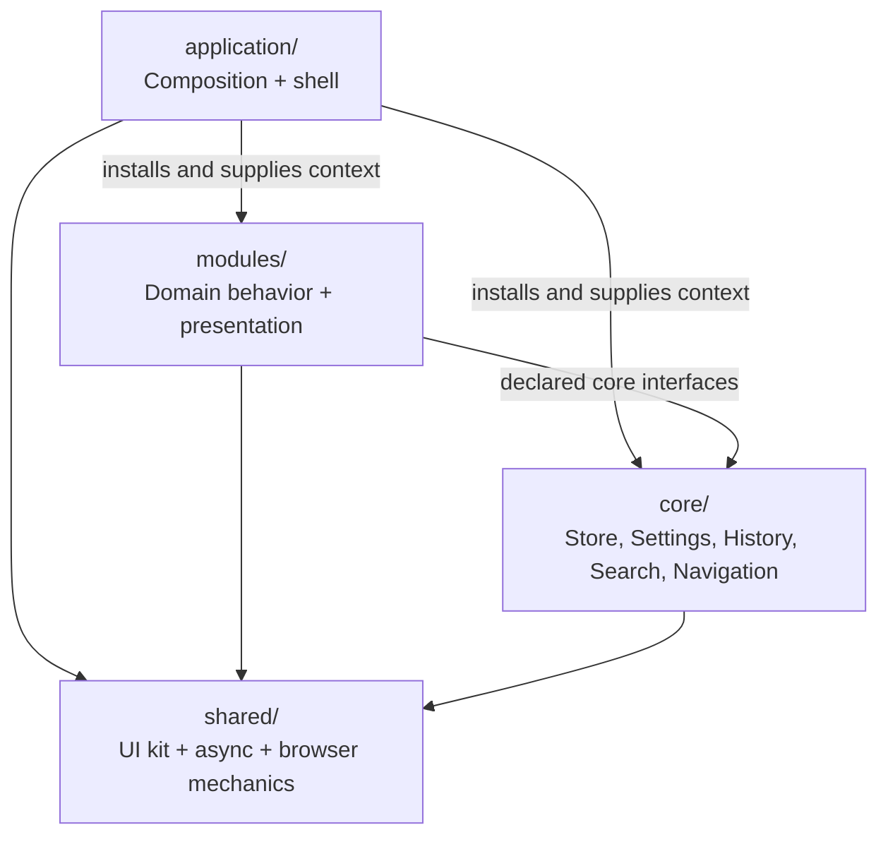
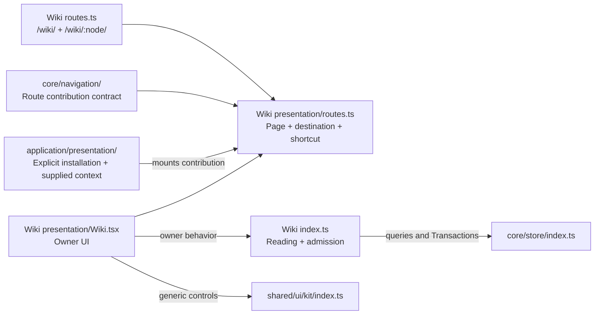
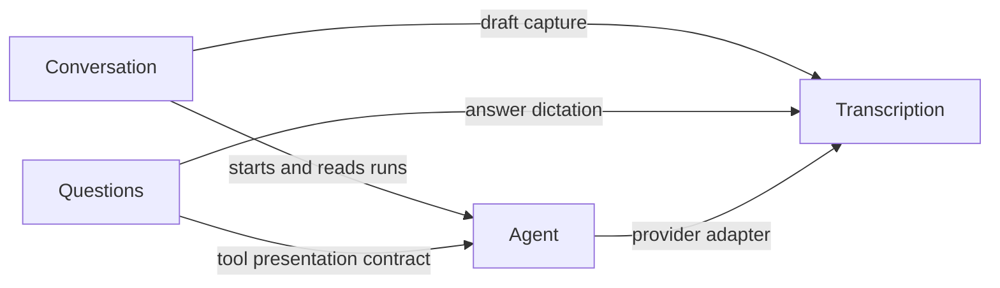
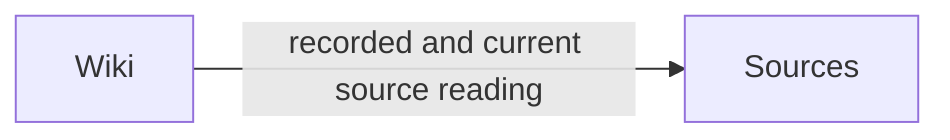

# Project layout and ownership

Start with the module that owns the concept. Core and domain modules both contain behavior,
retained definitions, reading, presentation and route declarations. Application installs their
contributions and supplies context. Shared contains generic mechanics.

```text
app/
├── main.tsx                         Production bootstrap
├── application/                     Product composition
│   ├── composition/                 Database registry, identities and cross-module joins
│   │   ├── database.ts              Assemble definitions; open one typed database
│   │   ├── composition.ts           Supply context, tools and adapters
│   │   └── wiki-graph.ts            Join Wiki pages with Graph Topics
│   ├── presentation/                Application shell and mounted module lifetime
│   │   ├── index.tsx                Register module pages and navigation contributions
│   │   ├── Frame.tsx                Supply navigation to the UI kit
│   │   └── SettingsCards.tsx        Compose owner-defined settings fields
│   └── runtime/sw.ts                Offline application asset caching
├── core/                            Core-owned modules
│   ├── store/                       Typed records, Transactions, Snapshots and exact save retry
│   ├── persistence/                 Journal transport and cache
│   │   └── presentation/            Connection preferences
│   ├── session/                     Unlock, credentials, refresh and journal lifetime
│   │   └── presentation/            Gate and session controls
│   ├── settings/                    Preference persistence and credential editing
│   │   └── presentation/            Setting fields and Settings navigation contribution
│   ├── history/                     Accepted Transaction reading and compensation
│   │   └── presentation/            History drawer, list and navigation contribution
│   ├── search/                      Ranking and recent destinations
│   │   └── presentation/            Search palette, commands and Agent handoff
│   └── navigation/                  Route contract, matching, transitions and key bindings
├── modules/                         Domain-owned modules
│   ├── actors/                      Attribution and atomic account binding; no standalone UI
│   ├── sources/                     Source documents and provenance; no standalone UI
│   ├── transcription/               Capture lifetime; caller owns draft association and UI
│   ├── conversation/                Dialogue, Exchanges, context and recovery
│   │   └── presentation/            Chat pages, pane, timeline, settings and routes
│   ├── agent/                       Runs, Model steps, tools and effect recovery
│   │   ├── openai/                  Provider adapters and configuration
│   │   └── presentation/            Settings and recorded/live activity views
│   ├── wiki/                        Pages, content, Appearance and Page references
│   │   ├── reviews/                 Review validation, admission and support reading
│   │   └── presentation/            Wiki pages, rendering, support views and routes
│   ├── graph/                       Topics, membership, Relationships and vocabulary
│   │   └── presentation/            Graph exploration and routes
│   ├── questions/                   Questions, Answers, collection lifetime and save recovery
│   │   └── presentation/            Questions, embedded Answers, tool views and routes
│   ├── calendar/                    Time values, Events and annual dates
│   │   └── presentation/            Calendar page, timeline and routes
│   ├── decisions/                   Recorded choices, rationale and provenance
│   │   └── presentation/            Global decision log and embedded records
│   ├── tasks/                       Tasks, fixed status workflow and provenance
│   │   └── presentation/            Task board, embedded cards and routes
│   └── map/                         Coordinates and geographic values
│       └── presentation/            Map page and routes
├── shared/                          Mechanics independent of product modules
│   ├── ui/kit/                      Controls, responsive layout, theme, focus and scrolling
│   ├── async/                       Serialization, cancellation and reported background work
│   └── browser/                     Safe URL handling for content renderers
└── preview/                         Fictional composition and scripted adapters
```

## Ownership and dependency direction

Application owns assembly and global product context. Core owns application-wide capabilities.
Domains own their concepts. Core and domain modules use declared public interfaces; Shared imports
neither Core, Application nor domain modules. Being used by several modules does not make behavior
Shared. Search is core-owned because its ranking and interactions are product decisions.

Boxes identify homes; arrows mean **uses a public interface**. This overview shows allowed dependency
roles, not permission to import arbitrary implementation files.



Core modules declare their own dependencies. Store remains independent of Navigation and UI.
History reads accepted Transactions through Store; Settings provides preference persistence;
Session owns credentials and connection lifetime; Search uses Navigation and UI kit controls.
The store engine knows no domain schemas: Application's `composition/database.ts` combines
owner-defined records. Transactions and History remain core-owned.

## Module convention

```text
<module>/
├── index.ts                         Public behavior entry
├── records.ts                       Retained definitions, when owned
├── operations.ts                    Writes and admission, when needed
├── reading.ts                       Reading and projection, when needed
├── configuration.ts                 Configuration meanings and validation, when needed
├── routes.ts                        Typed URL identities, when the module has routes
├── <named-behavior>/                 Private cohesive behavior, when needed
└── presentation/                    When the module has UI
    ├── index.ts or index.tsx         Public presentation entry
    ├── routes.ts                    Associate owner route patterns with owner views
    ├── navigation.ts                Drawer/action contributions, when needed
    ├── <Module>Page.tsx              Module-owned page
    ├── Settings.tsx                 Owner-specific settings fields, when needed
    └── ...                          Embedded views, hooks and rendering
```

The entries and presentation location are consistent; private filenames follow domain vocabulary.
Small modules do not need empty directories. `view.ts`, `projection.ts`, `suggestions.ts` and
`activity-data.ts` name outward values. Domain operations and recovery remain usable without React;
presentation hooks and rendering stay under `presentation/`. Tests live beside what they verify;
cross-module scenarios live under `application/`.

## Module-owned routes and navigation

Each routable module declares its URL patterns, page presentation, destination label, icon and
navigation shortcut. Core Navigation provides `definePage`, matching and transitions. Application
registers the contributions explicitly and supplies database, session and foreign context.
There is no filename-based route discovery or global module registry.



In this registration diagram, incoming arrows identify inputs to a route contribution; the
Application arrow identifies the caller mounting it. Settings and History contribute drawer
navigation and commands while their existing URLs retain the Chat background. Search combines
module destinations and commands with ranked results. Module-local search belongs to its module.
Changing a module's routes, page or destination stays local. Installing or removing a module changes
Application composition. Existing URL patterns and persisted entity/attribute keys remain stable.

## Domain connections

These dependencies carry domain meaning and stay explicit. `A → B` means A uses B.





Conversation, Agent, Wiki and Questions use Actors directly for attribution. Account binding occurs
inside the producer's Transaction. Application supplies author references to Calendar and Map.
Agent execution remains independent of Conversation. Wiki and Questions remain independent;
Application supplies foreign renderers and context to combine them.

## Application joins

| Composition | Modules connected | Supplied context |
| --- | --- | --- |
| Wiki Topics | Wiki + Graph | Topic membership and classifications |
| Subject calendars | Wiki + Calendar | Subject descriptions and time context |
| Map choices | Map + Wiki, Calendar, Questions, Sources | Foreign record choices and descriptions |
| Question context | Questions + selected foreign records | Selected evidence and trusted user identity |
| Search entries | Search + searchable modules | Entries derived through owner reading |
| Agent tools | Agent + tool owners | Tool adapters and trusted execution context |

Each domain interprets its own records. Initial Exchange and Agent run acceptance remains atomic.
Save recovery republishes the exact failed request without repeating a provider or tool effect.
Preview supplies fictional adapters through public entries; production cannot reach preview records.

## Framework inspiration

SvelteKit and SolidStart separate route entry points from reusable feature presentation. Here each
module declares its routes and views, and Application explicitly installs them. Browser transports,
IndexedDB and workers occupy the adapter roles that a fullstack application might perform on a server.
No framework migration or server runtime is required.

Compiler-resolved checks in `tools/architecture/layout.test.ts` enforce declared domain dependencies,
public entries, private store access, generic kit ownership and preview isolation. Follow the
[testing guide](../docs/agents/testing.md) for focused checks and commit-specific CI verification.
