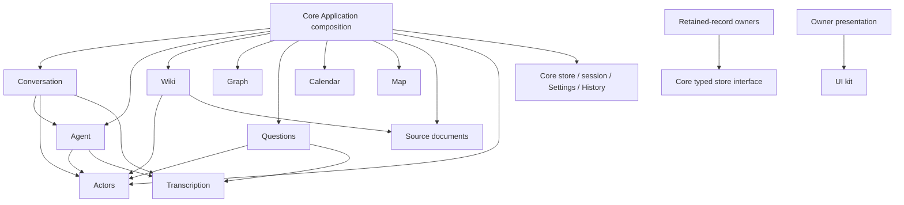

# Project layout and ownership

Start in the domain that owns the behavior. Its retained definitions, operations, reading and
presentation live together. `index.ts` is the behavior entry; `presentation/index.tsx` (or `.ts`)
is the presentation entry when one exists. Implementation files stay private to their owner.

```text
app/
├── application/                 Core application
│   ├── database.ts              Compose owner definitions; open one typed database
│   ├── composition.ts           Compose domain behavior and trusted context
│   ├── store/                   Entities, Transactions, Snapshots, history, exact save retry
│   ├── persistence/             GitHub journal transport, cache and connection preferences
│   ├── session/                 Credentials, unlock, refresh and journal retirement
│   ├── settings/                Shared preference persistence and credential presentation
│   ├── history/                 Transaction inspection and History drawer
│   └── index.tsx                Navigation, global presentation and mounted owner lifetime
├── actors/                      Attribution identity and atomic account binding
├── sources/                     Source documents and recorded/current source reading
├── conversation/                Conversation, Exchanges, Messages, context and recovery
│   └── presentation/            Chat page/pane, dialogue timeline and text rendering
├── agent/                       Agent runs, Model steps, Tool executions, text/voice effects
│   ├── openai/                  Provider transport adapters and configuration
│   └── presentation/            Agent settings and recorded/live activity views
├── wiki/                        Pages, content, Appearance and Page references
│   ├── reviews/                 Review records, selection validation and admission
│   └── presentation/            Wiki pages, support views and semantic rendering
├── graph/                       Topics, membership, Relationships and vocabulary
├── questions/                   Questions, Answers, collection lifetime and save recovery
├── calendar/                    Time values, Events and recurring annual dates
├── map/                         Coordinate records and geographic values
├── transcription/               Capture lifetime and transport contract
├── search/                      Ranking, recent entries and search interaction
├── navigation/                  Routes, commands and keyboard navigation
├── ui/kit/                      Generic presentation and browser mechanics
├── runtime/                     Small independent runtime utilities
└── preview/                     Fictional records and scripted transport adapters
```

## Ownership and dependencies



| Module | Owns | Caller supplies |
| --- | --- | --- |
| Core store | Typed records, identity, queries, atomic Transactions, recorded history and exact publication retry | Composed owner definitions; persistence adapter |
| Core session | Unlock, credential changes, cache readiness, refresh and journal retirement | Production or fictional persistence factory |
| Core Settings | Preference persistence and safe credential editing | Owner-defined field meanings |
| Core History | Generic accepted Transaction inspection and drawer presentation | Shared database and permitted compensation context |
| Actors | Actor records and account binding inside a producer's Transaction | Trusted account identity; caller's Transaction |
| Sources | Source document records, provenance and recorded/current projection | Shared database |
| Conversation | Dialogue identity, admission, draft/capture association, Exchanges, context checkpoints and recovery | Agent execution and owner tools; trusted identities |
| Agent | Configuration snapshots, runs, supplied Context inputs, Model steps, Tool executions and effect recovery | Model/voice transport and owner tool adapters |
| Wiki | Content, containment, availability, citations and Wiki Review admission | Source reading and foreign presentation |
| Graph | Topics, membership, Relationships and exploration | Foreign record descriptions |
| Questions | Question/Answer admission, collection subscriptions and answer save recovery | Database, trusted user identity, readiness and selected foreign context |
| Calendar / Map | Their native records, value interpretation, writes and reading | Foreign subject descriptions and trusted attribution |
| Transcription | Capture connection lifetime and output identity | Transport adapter; draft association stays with its caller |
| UI kit | Shared geometry, input, focus, scrolling and generic controls | Owner presentation content |
| Preview | Fictional records and scripted adapters | Public owner interfaces and explicit test seams |

Cross-domain joins belong in Application: Wiki Topics, subject calendars, Map record choices,
Question context, search entries and Agent tool composition. Each domain interprets its own records.
Conversation uses Agent execution directly because that is a semantic dependency; Agent runs remain
independent of Conversation. Questions uses Agent's shared tool presentation contract.

`records.ts` contains retained definitions. `configuration.ts` validates configuration;
`suggestions.ts`, `activity-data.ts`, `view.ts` and `projection.ts` name outward values and reading.
A private subfolder names cohesive behavior (`wiki/reviews`), rather than a generic `data` owner.

The core store has no knowledge of domain schemas. `application/database.ts` assembles the registry.
Actor binding stays inside the producer's atomic Transaction. Initial Exchange and Agent run
acceptance remains atomic. Save recovery republishes the exact failed request without repeating a
provider or tool effect. Directory and TypeScript names are independent of stable persisted entity
and attribute keys.

Tests sit beside the owner they exercise; cross-owner scenarios sit in `application/`.
`tools/architecture/layout.test.ts` checks public entries, dependency direction, private engine
access, presentation mechanics and fixture isolation. Use the [testing guide](../docs/agents/testing.md)
for focused local checks and CI verification.
