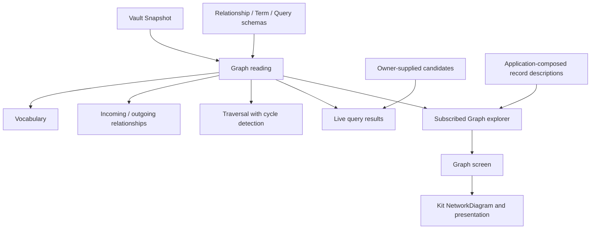

# Graph

Graph owns Relationship, Term and Query payloads and reads their meaning from a selected Vault
Snapshot. It accepts Node reading; it neither creates a persistence adapter nor imports another
workflow. Application composes Graph's source reader and exposes `applicationGraph(nodes, sequence?)`.

| Entry | Interface |
| --- | --- |
| [records.ts](./records.ts) | `graphSchemas`, payload types and `parseGraphRecord` validate the retained import shapes without rewriting JSON |
| [reading.ts](./reading.ts) | `readGraph(snapshot)` indexes relationships and vocabulary once, then supplies `vocabulary`, `relationships`, `traverse` and `query` |
| [sources.ts](./sources.ts) | `graphSources` retains historical text and description semantics for Graph-owned records |

## Snapshot and relationship semantics

The index includes live records in the Snapshot's containment forest. Deleting a container hides
its descendants from the index without deleting their versions. Restoration reveals them again.
Connection targets do not pull historical relationship records into the live index.

Connection source and target determine the relationship independently of placement. For an unresolved
relationship without a connection, its placement parent supplies the subject and its payload retains
the unresolved label. An unplaced unresolved record has no discoverable subject. Endpoint state
distinguishes available, deleted, missing and unresolved. An exact endpoint can be available while
its `current` identity version is deleted; both values remain inspectable.

`relationships(address, selection?)` defaults to both directions and accepts a predicate filter.
An identity address matches references to any version of that identity. An exact address matches
only endpoints resolving to that version in the viewing Snapshot. Self relationships appear once.
Results are ordered by relationship identity. Predicate definitions are Terms in scheme `predicate`;
their `label`, `inverse` and `symmetric` values supply outgoing and incoming labels. Missing or
ambiguous definitions fall back to the predicate key. Vocabulary keeps duplicate definitions
inspectable and orders Terms by scheme, key and identity.

`traverse(address, selection?)` performs breadth-first relationship traversal. It starts at the
addressed live version, follows available endpoints, retains distinct exact versions of one identity
and stops cycles. It returns discovered versions and relationship records, including unresolved or
deleted destinations encountered along the way. It defaults to both directions and unlimited depth;
`maxDepth: 0` returns only the root. Invalid depths throw. A missing or deleted root returns an empty
result. This is relationship traversal, distinct from the Vault's containment-and-target Closure.

## Live queries

`query(payload, candidates)` filters caller-supplied collection members using outgoing `type` and
`tag` relationships. Both filters must match when supplied. A connected classification must resolve
to a live Term with the requested key; an unresolved classification matches its retained label.
An exact source classifies only that version of the candidate. Exact live Term targets remain usable
after the Term identity is edited or deleted. Term schemes remain inspectable; `tag` may address
Terms from schemes such as `area`, rather than only scheme `tag`.

The collection owner supplies each candidate's identity, title and optional creation date from the
same Snapshot. Graph does not infer page membership or decode page payloads. Deleted or absent
candidate identities are excluded, duplicate identities collapse to the first supplied candidate,
and results retain the original candidate values. Sorting uses ascending title by default or ascending
creation date, with absent dates first and identity as the deterministic tie breaker. Candidate arrays
are never mutated.

A Graph reading stays at its original Snapshot. Read a new Snapshot after acceptance to obtain a new
live result; callers own subscriptions. Index construction is linear in live containment plus
vocabulary sorting. Relationship lookup uses source and target identity indexes; traversal visits each
reachable version once. Very large graphs should use a depth bound for interactive exploration.

## Integration scope

The reserved Graph schemas and historical source interpretation have moved from `vault/records` into
this module. Consumers of the old `vault/records/graph.ts` entry must use `graph/records.ts` when
advancing their Vaulter pin. The payload shapes remain unchanged.

The Graph screen is available from the sidebar, the compact Modules menu and the `g g` command.
`/graph/` opens the subject with the most connections; `/graph/:node/` retains a selected subject
through reload. Connections supports subject search, incoming/outgoing filtering, a diagram of up
to six nearby subjects, a complete relationship list and source links. Vocabulary exposes scheme,
usage, inverse and symmetric labels. The diagram uses the public kit's `NetworkDiagram` with native
keyboard-accessible buttons. Graph owns the subscribed reading lifetime in `explorer.ts`, retaining
the previous result on a failed refresh and rejecting late responses after replacement or disposal.
Application supplies descriptions from record owners; Graph never imports Wiki.

Publication actions, Agent tools and migrating Wiki's existing presentation projections to an
Application-supplied Graph reading remain subsequent slices. Wiki's current presentation stays
compatible with stored Graph records. Workflow isolation prohibits Wiki importing Graph directly.

