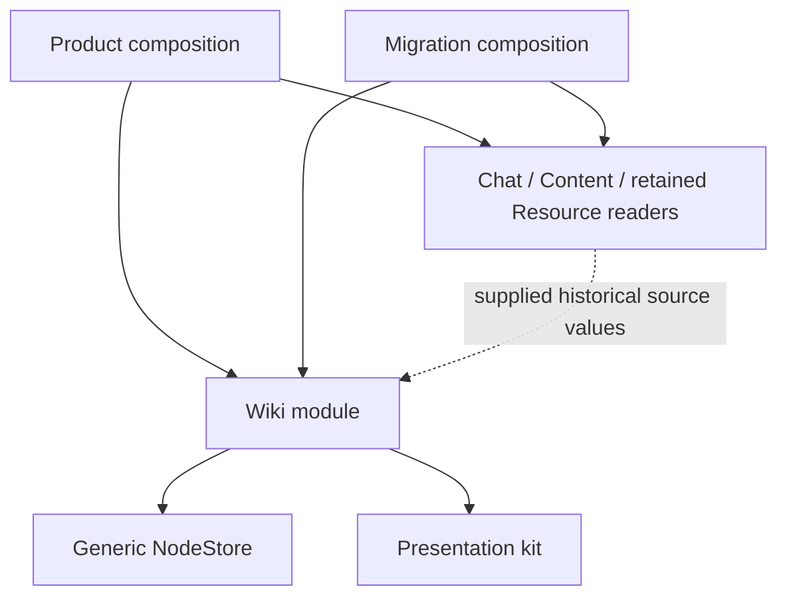

# Wiki module ownership

Status: approved and implemented. Focused verification passed; complete verification runs in CI.

Wiki's record definitions and Citation rules were split between `app/vault/records/`,
`app/workflows/wiki/`, and migration, and its collection presented flat `content` records as pages.
This refactor gives Wiki ownership of its definitions and behavior and presents other modules'
content only as referenced source material.

## Settled ownership

- One Wiki module lives in `app/workflows/wiki/`. It owns Page, block, inline, Citation and Page
  reference shapes, their containment rules, historical selections, reading and rendering.
- Only actual `page` records enter the Wiki collection, page queries and Wiki-derived search entries.
  Other modules' records do not receive Wiki page routes or synthesized Wiki paragraph bodies.
- Other modules own the interpretation of their source records. Chat supplies retained message
  prose, exchange framing, title, speaker and date. Content and retained Resource reading supply
  their own source values. Product explicitly connects these readers to Wiki.
- Wiki owns selection validation, source eligibility, Citation construction and interpretation,
  current-claim applicability, and historical source availability.
- Migration depends on Wiki. Wiki never imports migration, Node-only tools, their identifiers,
  review files or reports. Migration invokes the same Wiki rules used by application reading.
- Vault nodes continue to own generic JSON, Node addresses, Node versions, Containment, Connection,
  Snapshot and Transaction acceptance. Wiki does not become a second store.
- The kit continues to own shared presentation. Wiki owns the interpretation supplied to it.

## Shape of the implementation

Keep ordinary named exports for reading, record validation and reference preparation. Use a small
React adapter for the Wiki reading lifetime. Pure `.ts` entries must be usable by migration without
importing React, routing, presentation or browser transport.

Wiki absorbs its schemas, containment and historical selection implementation from
`app/vault/records/{wiki,citations,text}.ts`. Remove the parked Wiki definitions and their old
forwarding paths; the remaining Vault record collection contains only unclaimed record kinds.
Migration composes validation from the owning modules rather than making Vault import Wiki.

The source-reading seam supplies normalized historical text and source description. Source readers
receive the same selected Snapshot and may request text for children through Wiki's traversal.
Chat interprets its own `message.parts`, `message.text` and `exchange.preamble`; Wiki does not
inspect those fields. Shared source-reading types must not introduce a Chat-to-Wiki import.
Source owners also identify their non-prose records explicitly. Empty source text and unsupported
source formats are different outcomes; Wiki must not guess unknown payload meaning from arbitrary
`text`, `content` or `parts` fields.

Wiki owns the existing paragraph/run/list/table text grammar wherever those records appear.
Existing retained sources contain these text records beneath Resource and Chat roots; that does
not make their enclosing sources Wiki pages. Historical ancestry to a `page` determines Wiki
membership and source exclusion. Keep traversal/cycle protection inside Wiki rather than asking
each caller to reconstruct text traversal.

Wiki reference preparation validates historical endpoints and selections, eligible claim kinds,
unchanged current claims and their descendants, and evidence relationships. It returns prepared
changes and read expectations; it does not publish. Migration supplies its stable identities,
ordering and trusted authorship, retains the complete request, and publishes or verifies through
the generic store as before.
Descendant version expectations do not guard newly inserted children. Preserve migration's exact
baseline constraint and make the protection for any application write explicit in its preparation
and acceptance path.

Wiki reading owns history pagination, snapshot reuse, current source comparison and Citation
projection. Its lifetime adapter owns subscription, loading/error state, stale-read rejection and
cleanup. Product supplies store/source readers/navigation and consumes the resulting collection;
it does not assemble historical citation interpretation or own the reload loop.
Wiki also supplies its claimable text and provenance reading to migration. Detecting source sections
and deciding which Wiki text can hold a Citation belong to Wiki; lexical ranking, bounded review
packets and reviewer decisions remain migration behavior.

## Historical constraints

- Preserve all accepted record shapes and history; no regeneration or replacement of published
  migration history.
- Existing UTF-16 selections retain exact projection semantics: adjacent prose fragments
  concatenate, blocks use newlines, table cells use tabs, preambles precede turns, and tool activity
  contributes no source prose. Empty table cells and surrogate-pair validity remain significant.
- Exact addresses never fall back to live text. An exact container still uses the selected
  Snapshot for its descendants.
- Edited or deleted sources retain the original passage and truthful availability notices.
  Edited claims withhold old support while retaining the Citation in history.
- Existing whole-source citations and explicit Page references remain readable.
- Preserve migration's deterministic identities and retained originating link versions exactly;
  its hashing namespace and Node-only implementation stay in migration.
- A source without an application destination still appears as historical evidence with a plain
  title and expandable context. Do not invent a Wiki route for it.

These constraints implement ADR 0002, 0005 and 0006; no existing ADR needs reopening.

## Work sequence

1. Move Wiki definitions and validation into Wiki; update migration schema composition and callers.
2. Add owner-supplied source interpretation in Chat, Content and retained Resource reading; wire it
   explicitly in Product, migration and fictional previews.
3. Concentrate Citation/Page reference preparation and validation inside Wiki. Keep migration's
   Git reading, review packet selection/ranking, deterministic identities and reports in migration.
4. Restrict Wiki collection and route resolution to owned pages; preserve cited foreign content.
5. Move subscribed collection reading into Wiki and keep Product composition small.
6. Add focused ownership enforcement, update architecture/spec documentation, and verify.

## Verification

The interface is the test surface. Move schema/selection/evidence behavior tests to Wiki when their
behavior moves; keep migration tests for migration orchestration and exact deterministic output.
Keep source-format tests with their owners and application integration tests with Product.

Focused coverage must establish:

- Only Wiki pages enter its collection and queries; foreign content remains available through
  citations without broken Wiki navigation.
- The same historical source text and attribution survive module relocation, later edits/deletion,
  mixed text/tool records, source-contained paragraphs, and more than one history page.
- Citation preparation rejects wrong snapshots, invalid UTF-16 ranges, stale composite claims,
  Wiki sources, self/circular evidence and mismatched review quotations.
- Migration still produces identical retry identities and retains all original records/text;
  it consumes owned Wiki rules rather than duplicating them.
- Wiki cannot import migration; generic Vault records cannot acquire Wiki definitions; other
  workflows cannot import Wiki; source interpretation is explicitly composed.
- Wiki reading cleanup and stale-read handling survive source/store changes and React effect replay.

Use focused Wiki/source-owner/migration/Product behavior checks and
`npm run test:architecture -- tools/layout.test.ts`, with lint and type checking. Select browser
checks for Wiki evidence and source navigation if their wiring changes. Full-suite verification
runs in CI after committing and pushing the feature branch, following `docs/agents/testing.md`.

Recorded local verification: 59 behavior tests across Wiki, source owners, migration, Product and
preview records; 25 compiler-backed layout tests; lint and type checking; three Wiki preview browser
scenarios and the production Wiki-to-Chat evidence navigation scenario. Old and new enrichment
requests and reports compare equal, including deterministic retry identity and source-edited retries.
