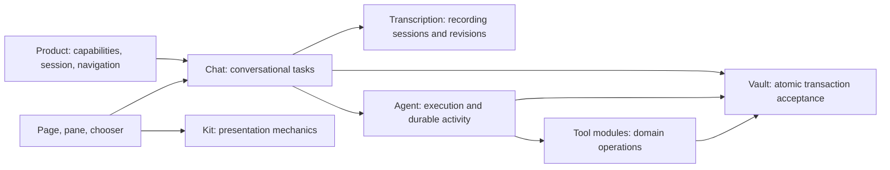

# Chat effect ownership

Delivered interfaces for [spec #52](https://github.com/JimLundin/vaulter/issues/52), through
tickets #53–#60. Current contracts live in [Chat production](../chat-nodes.md),
[Architecture](../../ARCHITECTURE.md) and the [kit guide](../../app/ui/kit/README.md).
They follow [ADR 0006](../adr/0006-module-ui-and-shared-presentation.md) without changing
Vault schemas, storage authority or shared pane presentation.

| Owner | Delivered contract |
| --- | --- |
| Chat | `prepareSubmission`, retained review/confirmation, draft source revisions, selection outcomes, once-only prompts, capture association, shared recovery and unread acknowledgement |
| Transcription | Independent admission/provider lifetime, valid session revisions, scoped cancellation/Finish, terminal cleanup; never mutates a Chat draft |
| Agent | Effective context, accepted invocation/outcome sequencing, Stop and exact-request recovery; a known effect is never repeated to save its outcome |
| Tool module | Domain validation and attributed publication through its supplied capability |
| Vault | Immutable versions, atomic acceptance/conflicts, snapshots and retry identity |
| Product | Explicit capability injection, stable session scope, visibility and navigation reconciled with owner outcomes |
| Views/kit | Owner state/actions, focus/disclosure and shared pane/composer mechanics |

Chat's preparation outcome distinguishes blocked intent, retained staged-change review and locally
owned request. Local ownership retains text/identity before clearing only its source revision; model
execution still waits for durable initial Chat/Agent acceptance. Raw Chat `submit`, `submitDraft`,
`send` and `sendDraft` migration paths are retired. Independent backend Send remains available.
New/Open recheck shared permission; the latest eligible intent wins and blocked intent preserves
valid work. Review and retained prompts cannot silently submit against a superseded conversation.

One owning application session retains draft/review/selection/prompts and accepted run across view
closure. It adds no draft/review persistence across reload. Same-session capability changes affect
subsequent explicit work; existing execution/recording keeps admitted context. Fresh session/effect
replay creates fresh owners. Destruction invalidates local continuations and releases owned resources,
while already-entered acceptance/domain effects retain their independent obligations. Chat borrows
Transcription and cancels only recording it admitted.

The deletion test is visible in actual consumers: removing Chat coordination would require Product,
page/pane and chooser to reconstruct submission admission, source handoff, review evidence,
transcript association, prompt claim/use, selection ordering and recovery/unread policy. They currently
request meaningful tasks and consume owner state. Recording/provider or Agent execution mechanism
changes stay behind their independent interfaces. This is substantial conversational ownership,
without a universal dispatcher or registry.

Validation crosses the supported interaction with real Memory NodeStore, scripted external providers
and mounted React/browser consumers. Retained regressions cover submission/review, recording late
output, selection versus review/prompts, changed capabilities/session shutdown, coalesced recovery,
Stop/reload and no replay. Ticket #60 adds failed-read/response-save unread acknowledgement and actual
Search New permission during recording/recovery. Compiler checks continue to cover declarations and
helper paths without new exemptions. Final integration review and full unit/UI/production/build gates
are recorded with the implementation workflow's evidence, against its final source.
