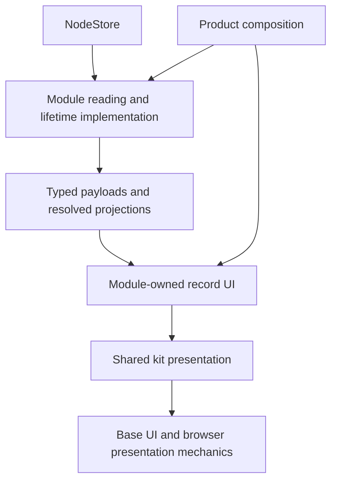

# Module-owned UI with shared kit presentation

Status: accepted direction; application migration not implemented. Decision:
[ADR 0006](../adr/0006-module-ui-and-shared-presentation.md).

## Implementation tickets

The approved task graph is published in GitHub. Native blocking links determine the implementation
frontier; the independent starting tickets are #44, #48 and #49.

| Ticket | Delivery | Blocked by |
| --- | --- | --- |
| [#44](https://github.com/JimLundin/vaulter/issues/44) | Shared pane through conversation selection | None |
| [#45](https://github.com/JimLundin/vaulter/issues/45) | Chat-owned UI and shared pane | #44 |
| [#46](https://github.com/JimLundin/vaulter/issues/46) | Wiki-owned page composition and shared pane | #44 |
| [#47](https://github.com/JimLundin/vaulter/issues/47) | Shared source-passage disclosure mechanics | #46 |
| [#48](https://github.com/JimLundin/vaulter/issues/48) | History-owned transaction UI | None |
| [#49](https://github.com/JimLundin/vaulter/issues/49) | Search-owned task UI | None |
| [#50](https://github.com/JimLundin/vaulter/issues/50) | Module previews without production preview coupling | #45, #47 |
| [#51](https://github.com/JimLundin/vaulter/issues/51) | Complete enforcement and retirement of migration paths | #48, #49, #50 |

The first architecture delivery concentrates shared presentation policy and moves record-specific
UI to its owning module. Chat lifetime, Wiki reading cost and broader Agent/Vault implementation
privacy remain follow-up opportunities from the architecture review. They are not prerequisites
for this migration.

## Governing rules

- Each module owns its record interpretation, record UI, reading and task behavior.
- The kit owns base presentation and shared compositions. Actual reuse across modules is the
  extraction signal. A shared composition can have substantial implementation depth.
- Prefer a shared pattern over a feature-specific arrangement. Accept some UI/UX compromises to
  reduce presentation choices and concentrate design changes.
- Modules compose the kit without custom layout DOM, styling, viewport branches or presentation
  library access. Private helpers inside a module do not escape this rule.
- Record UI accepts typed payloads or module-owned resolved projections, plus selection and actions.
  It does not require a storage adapter or execution controller merely to display a record.
- Product explicitly composes workflow interfaces and foreign-record navigation. Workflows retain
  their existing isolation; the kit does not become a record renderer registry.

These rules concern responsibility, not file size. An earning module has depth when it hides
knowledge from callers. Moving a file or adding an export-only module does not deepen an interface
if its callers still coordinate the same implementation details.

## Rendering pipeline and test seams

A reading projection retains identity, payload meaning and any historical context its UI needs.
It may resolve children, relationships, attribution and explicit missing/deleted states. It is not
a second persisted model or a generic bag of preformatted strings. Simple records can use their
existing payload directly; no projection module is required merely for symmetry.

Reading and lifetime implementations own storage access, subscriptions and execution. Screen
containers consume them and compose record UI. Local presentation state such as expanded rows
can remain with a record view; draft and run lifetime do not depend on a mounted view. Kit
mechanics such as focus return and scroll ownership stay behind the presentation seam.

Tests cross the same interface as callers: reading tests use NodeStore adapters; record UI tests
use typed fictional data and actions; shared presentation tests exercise its browser behavior.
Historical projections preserve ADR 0002's snapshot semantics and ADR 0005's citation selections.
Reopening or rendering records must not execute an Agent run or rewrite retained data.

## Current friction and destination

The inventory was checked on main at `0c4e30b`. These are responsibilities to migrate or audit;
generic names below describe the target, not final exported interfaces.

| Current source | Responsibility currently mixed | Destination |
| --- | --- | --- |
| `ui/kit/conversation.tsx`: toolbar, welcome, message, surface and panel | Chat labels, role interpretation, task actions and page/panel arrangement | Chat owns interpretation and composition; kit owns reusable toolbar, message presentation, page/feed/dock and supporting-pane mechanics |
| `ui/kit/wiki.tsx`: `WikiPageSurface` | Wiki sections, reference actions, title behavior and reading/pane geometry | Wiki owns page composition; kit owns shared reading, section, toolbar and pane presentation |
| `ui/kit/screens.tsx`: `HistorySurface`, `HistoryEntry` | History copy, revert action and a Git-shaped `sha` field reused for transaction sequence | History owns transaction interpretation and actions; kit owns expandable row and metadata/action presentation |
| `ui/kit/screens.tsx`: `SearchSurface` | Search task copy mixed with responsive overlay and command-list geometry | Search owns task composition; kit owns reusable search/overlay mechanics justified by actual callers |
| `ui/kit/selection.tsx`, `primitives.tsx`, `conversation.tsx` | `SupportingColumn`, `ResponsiveSupportingColumn`, `AdaptivePanel` and `ConversationPanel` select different supporting arrangements | One kit-owned supporting-pane policy; module compositions supply content and task actions |
| `ui/kit/drawer.tsx`, `styles.css`, `parts/drawer.tsx` | `reading` and `supporting` choose different geometry and responsive behavior despite sharing Drawer | Private kit implementation of the common policy, preserving Base UI mechanics |
| `workflows/wiki/rendering/references.tsx` | Citation attribution plus custom card, clipping, expansion and scrolling mechanics under the renderer exception | Wiki owns citation interpretation; reusable card/disclosure/passage mechanics stay in the kit |
| `ui/kit/prototype-provenance.tsx`, `catalogue.tsx`, `index.ts` | Fictional record interpretation and design examples share the production kit interface | Preview owns fictional record examples; kit catalogue demonstrates shared presentation |
| `tools/layout.ts`, `tools/composition.ts`, `ui/kit/composition.ts` | Workflow/kit import rules exist; stricter composition checks cover only three declared kit sources | Enforce all module UI composition and explicit kit implementation ownership |

`Composer`, `SettingField`, Drawer and presentation policy already provide useful depth. Keep
shared form, keyboard, focus, portal and gesture knowledge concentrated. Audit semantic ownership
without assuming that every Chat-adjacent export must be removed: shared message-entry mechanics
can remain in the kit while Chat supplies submission and capture policy.

## 1. Define the shared presentation inventory

Classify each public kit export as base/shared presentation, record-specific UI or preview-only
presentation. Record the actual production consumers, overlapping mechanics and required behavior.
Start with supporting panes, toolbar/page composition, expandable rows and passage presentation.

Choose the smallest shared interface that expresses those existing tasks. Callers should choose
content, labels and actions rather than widths, breakpoints, padding or focus strategies. Keep
internal implementation seams private. Use existing browser and bounded-preview adapters;
introduce additional adapters only when something really varies.

Acceptance:

- Every audited export has an owner and a concrete migration destination.
- Shared presentation has real consumers; single-use feature composition stays with its module.
- No proposed generic interface mirrors a module's record schema or accumulates feature flags.
- Identify presentation behavior the migration will standardize, preserve or deliberately change.

## 2. Consolidate supporting-pane policy

Deepen the existing kit presentation module so all supporting panes use one policy. Retain the
existing Drawer/Base UI implementation where it earns its keep; consolidate the choices above it.
The shared policy owns width, header arrangement, scrolling, dismissal, focus return and the
responsive transition. It must also work inside bounded preview canvases.

Modules supply title/header content, body, task actions and requested visibility. The kit may
accept narrowly defined content arrangements needed by existing tasks, such as a scrollable body
or a feed with an anchored composer. Those arrangements use shared mechanics, not module names.
They must not reopen per-module choices of pane geometry or focus behavior.

Migrate the Chat supporting panel, Chat conversation chooser and Wiki references through this
same presentation seam. Remove obsolete presentation paths and role-specific CSS. When a selection
requires a scroll reset, the module reports that selection through the shared interface; it does
not query the scroll owner's private DOM. A change to shared pane design should then require kit
edits only.

Pane occupancy is not an optimization target. Preserve existing application choices about which
panes are open; Product remains the composition point. This migration does not add a singleton
pane manager, registration protocol or feature host.

Acceptance:

- Chat, conversation selection and Wiki references share the same presentation policy.
- Width, headers and responsive transition can be changed once without editing those callers.
- Keyboard dismissal, appropriate focus return, touch interaction and bounded portals work.
- Mounted content, draft, expanded source context and focus survive responsive rearrangement.
- A feed/composer does not gain a competing scroll owner; references use the common scroll body.
- Existing simultaneous panes still function; no new occupancy rule is imposed.

## 3. Move record-specific composition to its owner

Deliver one module at a time, beginning with Chat and Wiki because both consume the shared pane.
Move interpretation and feature copy from kit exports into module UI that composes shared kit
presentation. Then migrate History and audit Search. Reuse existing payload/projection types:
`SavedChat`, Chat message/turn data, `WikiPage`/`WikiBlock`/`WikiReference` and `NodeHistoryEntry`
already give starting points; retain meaningful evidence and precision rather than flattening them
to fit an old presentation export.

Separate subscribed containers from record views where the latter otherwise require an entire
controller or store to render. Do not create a chain of pass-through modules. Lists compose their
module's record views, while queries and lifetime implementations remain behind their own seams.

Remove migrated feature-specific kit exports after their callers move. Do not keep compatibility
aliases that preserve the obsolete ownership. Catalogue coverage applies to the resulting shared
kit interface; module-owned examples use fictional records through their real reading and
rendering pipeline in the preview.

Acceptance:

- Module record UI displays typed data with explicit actions and resolved availability states.
- Kit code and its exported types do not import workflow records, stores or execution controllers.
- Feature labels, record interpretation and navigation policy live with the appropriate owner.
- Historical identity, version, cutoff and citation meaning survive the migration.
- Changing shared presentation does not require recreating the same layout in each module.
- Removing a workflow leaves the kit and unrelated workflow implementations intact.

## 4. Close composition loopholes and enforce the seams

Extend the existing compiler-backed policies rather than introducing another checker with a
different dependency model. Protect module imports, presentation ownership and private kit access
through compiler resolution, including aliases, re-exports, dynamic imports and private helpers.
Give each kit presentation implementation an explicit role: it either owns DOM/library mechanics
or composes approved shared presentation. Check compositions without requiring private helpers
to become public or forcing every implementation file into a uniform folder template.

The current content-renderer exception must distinguish semantic content from application
presentation. Wiki block markup, formatted source text and safe links can have explicit semantic
rendering rules. The exception must not permit a renderer to implement pane geometry, custom
interactive card controls, viewport policy or independent scroll mechanics. Express passage,
disclosure and record-section presentation through the kit where needed. Arbitrary JSON requires
interpretation by its owner; generic rendering is not a reason to import another workflow.

Introduce the relevant rule alongside each migration slice. Temporary exceptions name their
reason and removal slice; they do not exempt a whole workflow or the kit indefinitely. Maintain
public kit coverage, shared composition checks and existing workflow-isolation checks. Module
view types should use their own payload/projection types; enforce this through ownership and
focused behavioral review rather than a naming rule that rewards fake projections.

Acceptance:

- A new module view cannot bypass presentation rules via an extracted helper or renderer path.
- Forbidden implementation imports fail through resolved aliases, re-exports and dynamic imports.
- Legitimate semantic content, private presentation implementation and test adapters pass.
- Adding a kit composition cannot silently omit its composition checks.
- Preview-only record examples are absent from the production dependency graph.
- A disposable workflow-removal check still verifies the repo's existing removal contract.

## Delivery and validation

Each delivery should reduce caller knowledge and remove a duplicated presentation responsibility.
Use separate reviewable changes for the shared pane, Chat/Wiki ownership, History/Search ownership
and remaining preview/enforcement cleanup. Add each slice's enforcement when its ownership becomes
true rather than postponing all rules until cleanup.

For shared mechanics, run typecheck, lint, compiler-policy/catalogue checks and focused browser
checks across phone, desktop, touch desktop and bounded samples. Verify the affected production
flows through fictional persistence/model adapters. Run the existing integration/recovery tests
when changed paths touch Chat/Agent execution. Full required CI remains the completion gate.
Tests verify behavior through the same interfaces as callers; do not add snapshot tests for every
new helper or duplicate tests whose only purpose is the old file arrangement.

Present any deliberate visible standardization in a fictional preview for review before merging.
An ownership-only move can retain the selected design; it does not require inventing new design
alternatives. Update ARCHITECTURE.md and the kit README to describe implemented ownership as each
slice lands. The glossary continues to describe domain concepts, not presentation implementation.

The deletion test for this plan is whether deleting a shared presentation module would redistribute
its design and interaction knowledge into several callers. Locality means one place to change pane
design; leverage means all consuming modules gain that change through a small shared interface.

## Completed slice: supporting pane and conversation chooser (#44)

`SupportingPane` is the shared presentation seam. Saved-conversation selection uses it in
production; the paired catalogue demonstrates neutral scrolling content and a following feed with
an anchored composer. The module supplies title/header content, actions, visibility and an optional
selection identity. Selection changes reset the kit-owned scrolling body. A feed supplies its
composer through `dock`, so it has one following scroll owner and a separate anchored dock.

The policy uses the shared `md` boundary: expanded and wide space place a 340px pane beside the
page; compact space uses the existing full-height bottom Drawer. Width, header arrangement, inset,
scrolling, dismissal, focus return, gestures and bounded portal behavior live in the kit.
`persistent` requests continued desktop occupancy; it does not select a presentation strategy.
The chooser retains its existing desktop occupancy, loading/error display, subscriptions and
selection actions. Recording now explicitly blocks chooser actions as well as the Chat toolbar.
The public pane has no styling, breakpoint, modal or focus parameters. Compiler checks cover its
composition, aliases/private imports and caller styling attempts.

| Temporary path | Named consumers | Retirement criterion |
| --- | --- | --- |
| `ConversationPanel` / `AdaptivePanel`, Drawer `supporting` | Product Frame, Chat/catalogue and browser fixtures | Chat adopts `SupportingPane` in #45; retire remaining examples and old geometry in #51 |
| `SupportingColumn` / `ResponsiveSupportingColumn`, Drawer `reading` | Wiki page references and legacy catalogue examples | Wiki adopts `SupportingPane` in #46; retire remaining examples and old geometry in #51 |

The new policy preserves the chooser's current presentation. Chat will deliberately standardize
from its intermediate centered dialog to the same expanded side pane when #45 adopts it. The
fictional paired pane examples expose that destination for review. No pane occupancy manager is
introduced, and existing unmigrated paths remain active until their owning tickets migrate them.

## Completed slice: Wiki page composition (#46)

`WikiPageView` owns typed page title/classification actions, block/record grouping and reference
selection. Shared reading/page/section presentation and `SupportingPane` own geometry and scrolling.
Selection uses the shared scroll-reset input; responsive rearrangement retains mounted source
context. The obsolete kit Wiki screen and dedicated shell CSS are removed. Wiki semantic content
has an explicit markup allowance; source-card mechanics remain only in the named #47 exception.
Toolbar's shared 48px header and Prose document presentation standardize existing callers. Typed
fictional preview `/preview/wiki.html` verifies actions and bounded responsive state; #50 extends
preview examples through fictional NodeStore readings and pairs.
