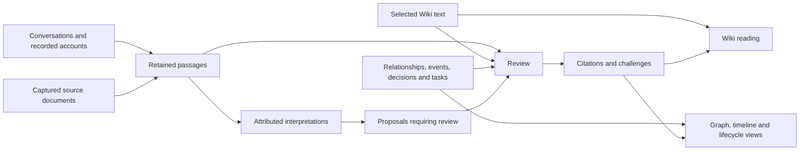

# Proposed Vaulter model and supported features

Proposal, revised 2026-10-16 for the EAV backend direction and broad-topic organization. Domain behavior was initially assessed against Vaulter `c88b4f5a757b354109381cd9ab1d2b404340fb88`; this revision also considers Graph at `3e7c111f9c6c87ff3371e311b7980e8b3d96a3ac` and the concurrent, uncommitted `feat/eav-engine` work in `app/vault/eav/`. That work is an implementation reference, not a pinned migration target. This remains a reviewable design, not an adopted schema, ADR or implemented feature. Proposed terms are defined in [the proposal glossary](knowledge-model/GLOSSARY.md); the accepted root glossary is unchanged. The [migration strategy](knowledge-model-migration.md) describes adoption gates and reconstruction work without source-specific content.

## Recommendation

Use the EAV backend for new domain storage, preserving stable identity, atomic transactions and readable history through an explicit migration. Domain owners define typed entities, attributes and references; the engine owns storage and transactional mechanics. Keep Wiki prose as prose, conversations as recorded source material, and Subject as the role played by a suitable retained identity. Add domain records only where they make a useful operation possible: qualified relationships, retained external documents, reviews, events, choices and commitments.

Organize knowledge under a small curated set of broad Topics, with narrower subjects and material underneath. Creating or retaining a page, person, place, project, tag or claim must not automatically create a top-level Topic. Graph starts with those broad topics and expands bounded detail on demand.

Treat a **Claim** as a reviewable assertion rather than a mandatory extra entity for every sentence. A sentence can be selected in its existing paragraph. A relationship or event can expose its own assertion for review. This gives the same evidence experience across prose and structured knowledge without duplicating everything into a universal claim store. An EAV storage fact records an attribute value; it does not by itself establish an evidence-supported assertion about the world.

The central distinction is between **what was recorded**, **what someone asserts or interprets**, and **what a review establishes that the source supports**. A successful evidence review does not independently prove that the world is as described.

## Model overview

Arrows show use and presentation, not permission to import another workflow's code or to accept an agent-generated conclusion automatically. Interpretations lead back to the underlying passages when reviewed; they do not become independent corroboration by passing through another module.

| Concept | Representation to retain or introduce | Features it supports |
| --- | --- | --- |
| Subject | Suitable retained entity identity, with explicit mapping from historical Node addresses; names/aliases and classifications remain owner-defined | Stable people/topic/place identity, search, ambiguity resolution and shared views |
| Topic and topic membership | Explicit promotion of a broad subject and editorial membership for narrower material | Small global graph, grouped navigation and bounded expansion without duplicate identities |
| Conversation, Exchange and recorded summary | Existing source records and their attributed history | Capture, dialogue, historical accounts, passage discovery and source context |
| Source document | New owned record for independently captured external material, with source text and provenance | Capture a Wikipedia/official-page excerpt, inspect revisions, cite exact retained passages |
| Wiki page and content | Existing independently versioned content; claims selected in that content | Readable knowledge, inline evidence and honest current/historical summaries |
| Relationship | Named connection plus explicit qualification and effective time | Reviewed graph facts, expected versus current roles, relationship history and time-sensitive queries |
| Citation, Challenge and Review | Version-bound evidence connections and review records | Missing/partial/disputed support, evidence attachment, review queues and review receipts |
| Interpretation | Existing concept, with adequate retained text, attribution and source links | Explain an inference, review an agent proposal, preserve corrections and reasoning |
| Event | Domain occurrence/scheduling record, time expression and participant/place references | Chronology, appointments, plans versus occurrences and event context |
| Decision | Adopted choice with actor, decision time, rationale and supersession references | Current direction, decision history and “what did I decide, and why?” |
| Task and Outcome | Commitment plus independently reviewed later outcome records | Follow-ups, ownership, due dates, completion/abandonment and reminders |
| Question and Answer | Existing owning workflow, integrated with unresolved review issues | Ask the person who can resolve a gap and retain the response as new evidence |

Existing charts, timelines, tables and dynamic note lists remain presentation over retained content. A benchmark dataset or richer query language can be added when an actual operation needs it; neither is a prerequisite for this model.

## EAV representation and historical compatibility

The target is an owner-defined domain model represented by EAV entities, attributes and references.
Do not wrap every old JSON payload in a single opaque attribute and call that the new model. Equally,
do not expose storage attributes as separate knowledge claims or graph nodes. The logical mapping
below specifies required meaning; exact entity declarations and migration APIs belong to implementation.

| Domain structure | EAV representation to design and validate |
| --- | --- |
| Subject identity and Topic | Reuse a suitable entity identity; record explicit topic promotion and membership. Separate display names and aliases from identity. A subject need not be a Wiki page or a top-level topic. |
| Wiki and source content | Independently addressable content with typed text/format attributes and child-owned parent/order values. Shared content uses separately addressable appearances referring to one content identity. |
| Qualified Relationship | An entity with source/target references, predicate, modality, attribution and effective-time values. Evidence and editorial placement remain separate from its assertion. |
| Review, Citation and Challenge | Addressable records with reviewer/result/rationale and exact assertion/passage selectors, including the historical snapshots and selector format. Support and contradiction can coexist. |
| Event, Decision, Task and Outcome | Owner-defined typed records with participant/responsibility references, honest time values and explicit outcome or supersession associations. Preserve the distinctions described below. |
| Transaction and historical address | Engine-owned atomic history with durable address resolution, trusted attribution and an explicit correspondence to old Node/Transaction addresses and snapshots. |

The inspected engine exposes entity definitions, scalar attributes, typed references, sets, inverses,
transactions, schema revisions and historical reads. These facilities do not supply the domain schemas
or prove the following migration contracts:

- **Identity and references.** Define durable serialization/resolution of entity and transaction
  addresses, plus a persistent mapping from old addresses. Opaque runtime entity objects and
  `sameEntity` are not saved migration receipts. Ordinary typed references need an explicit design
  for subjects and evidence targets owned by different entity types; do not duplicate each identity
  merely to satisfy one reference type.
- **Exact evidence.** An entity reference and a historical view are different things. Persist exact
  claim/source versions and the snapshots used to read dependencies; passing an object read from
  an old snapshot as an ordinary reference must not silently mean current evidence. Keep existing
  UTF-16 selectors and historical text projection unchanged.
- **Ordering and locality.** Sets cannot express ordered or repeated occurrences. Preserve explicit
  sibling order for paragraphs, inline text, turns and table cells, and appearances for shared
  content. Editing or moving one item must not rewrite all its ancestors or siblings.
- **Time.** An instant-valued datetime attribute is insufficient for day/month/year precision,
  approximation, recurrence or unknown time. Use the explicit domain time contract below.
- **History and removal.** Define old-schema interpretation, deleted-target availability, hidden
  descendants, restoration and attribution at historical snapshots. Rejecting an incompatible schema
  change is not a historical decoder or an implemented upgrade.
- **Durability and recovery.** The inspected backend supplies memory storage and callback transactions.
  Publication additionally needs durable acceptance, baseline validation, finalized request identity
  and acknowledgement recovery without rerunning inserts or external effects. Pin a tested backend
  revision before claiming these are available.

This direction replaces the earlier recommendation to retain generic Node storage. Preserve the
original published envelopes and their addressable history through faithful conversion or explicit
historical reading; a current-state export alone is insufficient. EAV recording time must not replace
original source, effective or transaction times. The storage migration and semantic reconstruction
are separately verifiable operations, even when delivered together.

## Subjects and relationships

### Subject identity

Do not create a second Subject identity beside every Wiki page. Preserve the subject represented by an existing person page through the EAV identity mapping so questions, relationships and events continue to refer to the same person. Application composition supplies name/alias descriptions from the owning records. An index for search and identity candidates can be rebuilt from those records.

A subject can retain an independent identity when several pages describe it or when its material is grouped under a broader topic. Define that identity/navigation migration explicitly. This does not require a new duplicate identity or a top-level topic for every old page.

An unresolved name is a pending mention with candidate identities, not an established edge to whichever person matched best. Preserve the literal wording. Shared first names do not establish a relationship, and a corrected spelling is not permission to merge two people.

### Broad topics and bounded Graph expansion

Topic is an explicit organizational role of a broad Subject. A Wiki page is a presentation of
knowledge; a narrower subject is something that knowledge concerns. Neither automatically qualifies
as a top-level Topic. Topic membership is editorial organization, distinct from factual relationships.

Default new material to an existing broad topic after resolving names and aliases. Promote a new
topic only for a recurring, independently useful area of inquiry or activity that existing topics
cannot represent clearly. A mention, heading, tag, source file, external definition or paragraph is
insufficient. Narrower concepts, tools, episodes and subject descriptions remain sections or attached
records. Preserve independent person/place/project identities where links and history need them.

Use a primary topic for navigation and explicit additional memberships when useful. Shared content
and sources keep one identity across those memberships. For example, a garden planning topic can
contain irrigation notes and tool descriptions while a contractor remains a distinct subject used
by an appointment. This does not require separate global topics for each tool or person.

Graph's global view should show promoted broad topics and relevant connections. Opening a topic
reveals a bounded neighborhood; statements, questions and sources expand on demand. Search and direct
links still reach unexpanded records. Query that neighborhood before constructing or laying out the
diagram, disclose omitted counts and allow explicit further expansion. Grouped edges must lead to
their underlying relationships without implying new factual assertions.

The Graph inspected at `3e7c111` instead receives every Wiki page as a topic, emits paragraph nodes,
enables all populations and limits records only after focus. Reducing tags or nesting pages alone
cannot fix that behavior. Topic generation and the application projection must change together.
Measure promoted topics, fetched records, rendered records and edges separately; choose the initial
topic set through source-specific review rather than an arbitrary content-deletion quota.

### Qualified relationships

A knowledge Relationship needs more than a predicate and two endpoints:

| Meaning | Required behavior |
| --- | --- |
| Subject, predicate, object | Resolved identities and a defined, directed predicate; preserve unresolved legacy labels separately |
| Modality | Actual-state assertion, expectation, intention or hypothetical; unknown remains unknown |
| Certainty | Retain explicitly expressed confidence and its attribution; no invented numerical probability |
| Attribution | Who made the assertion and whether it is reported or inferred; preserve a relevant reporting chain |
| Effective time | When the assertion applies, including open or unknown bounds and original precision |
| Evidence | Reviewable relationship assertion with version-bound supporting or challenging passages |

An **actual-state assertion** describes what the speaker claims is happening. The label does not certify truth. Likewise, **supported** means the selected passage supports the qualified assertion, not that the reviewer independently verified an appointment or diagnosis.

For example, a retained statement that a speaker expects a colleague to lead a project can become a `leads` relationship in expectation modality, attributed to that speaker, with unknown effective start. Accepting the evidence must not turn it into present leadership. If a later capture establishes the appointment, append reviewed actual-state knowledge; retain the earlier expectation in history and make the change explicit.

Graph defaults should separate reviewed actual-state assertions from expectations, intentions and unresolved proposals. Offer filters for effective time, attribution and review state. If effective time is unknown, show that state rather than silently treating the edge as valid forever.

Classifications and navigation connections are also named relationships, but they do not all need the same factual treatment. An editorial tag assignment is reviewed as an organization choice; it should not create a misleading Needs reference warning for every tag. An `instance-of` assertion about the world may need evidence. Let the owning action identify the role rather than guessing from the presence of an edge.

## Evidence and review

### A claim is a review unit

Ordinary Wiki statements remain selections of existing content. Structured records expose a defined assertion through their owner. No global Claim entity is required. Optional independently shared assertions should be introduced only when actual reuse needs a stable identity distinct from a paragraph.

Every review identifies:

- The exact content or record version and the snapshot used to interpret it.
- The text selection or complete structured assertion reviewed.
- Exact source passages, source snapshots and their attribution.
- Reviewer identity, time, rationale and result.

A Review result can accept support, identify contradiction, leave missing evidence, defer identity/meaning, or classify material as non-assertive navigation. It applies only to the selected assertion. Retrieval rank, number of sources, and an AI certainty score are not acceptance decisions.

Keep current display states derived from these records and the current assertion: **Needs reference**, **Partly supported**, **Supported**, **Disputed**, and **Needs review**. Supported assertions can also be disputed. These are related indicators, not one enum that erases disagreement or conflates confidence with support.

### Text and structured assertions need different selection contracts

Existing UTF-16 citation selections and their historical text grammar remain unchanged. Their exact claim and source addresses plus snapshots continue to be authoritative.

Summaries need an explicit claim selection too: today's plain `page.summary` field is not covered by paragraph selections. I recommend a versioned, owner-approved **field-text selector** for that field, with the exact page version and selected character range. It keeps the summary stored once while allowing support to attach to its actual text. This is a new selector contract, not a reinterpretation of old page text or an assertion that summaries are already citable.

For structured knowledge, add an explicitly versioned **whole-assertion selector**. It selects an owner-defined semantic projection of an exact Relationship, Event, Decision, Task or Outcome at a snapshot. That projection includes meaningful referenced subjects, predicate, qualifications and time. It excludes layout, provenance links and derived review/display state.

This avoids treating arbitrary JSON character offsets as a meaningful claim. The first structured implementation should review the entire assertion. If a passage supports the core relationship but not its asserted start date, narrow the assertion or leave it pending. Field-level evidence can be considered later with a clear contract; it must not hide unsupported qualifiers.

Changing a meaningful part of an assertion requires review again. Old evidence remains available historically. For prose, retain current literal-text matching: formatting that leaves selected text unchanged can retain support, but a paraphrase requires review even if a model thinks it equivalent. For structured assertions, an unchanged semantic projection can retain support despite a display-name or layout change. Changed subject identity, predicate meaning, modality or time cannot. Historical snapshots retain the original labels and dependencies used to interpret the assertion. Different projection semantics require a new selector format, never a silent reinterpretation of old snapshots.

### Citation ownership

General evidence mechanics can serve Wiki and Graph, but the present application owns Citation semantics in Wiki. Introduce an Evidence workflow for review records and new cross-domain support/challenge operations when Graph needs it. Claim owners supply projections and applicable validation through Application composition; Evidence supplies passage/selection/review validation. Domain owners retain permission to change their own records.

Keep old Wiki citations readable through their existing owner and decoder. A transition to broader evidence ownership needs a deliberate application design/ADR update; it does not authorize removing historical schemas or giving a generic publisher permission to rewrite arbitrary claims.

### Supporting sources

Keep Wiki pages and their descendants ineligible as underlying evidence, even when their prose repeats the same statement. Interpretations are derived knowledge: review their conclusions against their underlying passages, not against another distilled interpretation.

Retained user statements, agent reports and recorded summaries keep their attribution and limitations. An agent report can support “the agent reported X”; it is not automatically independent verification of X. An imported daily account can support an attributed historical account without becoming a reconstructed verbatim conversation. An independently recorded new user confirmation is new evidence with its own date, not a recovered old source.

Page references remain provenance. A bare external link remains a useful source lead. Neither establishes support for every nearby sentence.

## External source documents

A source document should retain title, canonical URL or other origin, capture time, upstream revision/publication time when actually known, source author/publisher when known, and the original captured text with enough context to inspect a passage. The transaction author records who captured it; that is distinct from the document's author.

Use typed, integrity-checked references for associations and owner-defined independently versioned text. A re-fetch creates a new retained revision. Old citations retain the original revision and snapshot; the UI can show newer available material. A URL that changes or disappears does not erase the reviewed passage.

Start with URL/excerpt capture and manual selection rather than a general crawler. Where retrieval fails, keep the URL as an unresolved lead and allow independent capture. Preserve which material was captured verbatim versus summarized by an agent.

A technical topic page can support its general explanation with a captured official documentation or Wikipedia passage, while its personal project stance cites the relevant conversation. Capturing a public definition still requires review of qualifiers such as "standard," "all inputs," and historical applicability.

## Time, events and lifecycle

### Keep three kinds of time distinct

Transaction recording time already exists. Source/reporting time says when an account was made. Effective or occurrence time says when the assertion describes the world. A page's `created` date is not automatically any of the latter two.

Use one shared, explicit time-value convention across domain owners: year, month, day or instant precision; approximate expressions; ranges; timezone where meaningful; and unknown values. Retain original phrases such as “around the middle of June” or “this autumn.” Normalize only what the expression and context establish. Do not invent an exact day, treat midnight as a known event time, or use an unknown value as an unbounded interval.

Recurrence, a date range and uncertainty are different meanings. A yearly birthday can be a calendar recurrence without inventing a birth year. A postponed appointment records a revised plan, not evidence that the original appointment occurred.

### Events

An Event groups a particular occurrence or scheduled occurrence, its description, participants, places and time. Distinguish planned, occurred, cancelled and unknown assertions. The evidence must cover the claimed status. Participant/place roles use typed references or association entities when role, order or qualification needs its own identity; unvalidated identifiers inside JSON lists are insufficient.

For an approximately dated procedure, retain the approximate occurrence time and the account that reported it. A planned procedure must not become an occurred procedure because its proposed date has passed. Medical explanations, causal interpretations and reported measurements can remain cited prose until an actual structured operation justifies more specific records.

### Decisions

A Decision states a choice adopted by an actor, when the choice was made at known precision, and its stated rationale. Record proposed alternatives and recommendations as proposals/Interpretations until adopted.

Keep reversals and replacements explicit. A new decision can supersede an old one through a reviewed relationship; it does not erase the original choice. The current-direction view derives from adoption and supersession history. For example, a decision to use a hosted service remains a real decision after a later choice to build a replacement.

### Tasks and outcomes

A Task is an explicit commitment, with responsible subject, action and optional stated due time. Wishes, general interests and inferred next steps remain proposals. No task should be assigned to a person merely because an agent thinks it would help.

Retain later completion, abandonment or rescheduling as reviewed Outcome records. The original commitment and its citation can remain unchanged; the current task state is derived from accepted outcomes. Evidence of the commitment does not support a completion assertion. A deadline passing, or removal from old frontmatter, establishes neither completion nor abandonment.

Reminders use the current task state and a real due-time expression. They must not silently convert an imprecise timeframe into a new historical fact or invent a commitment.

## Interpretations, corrections and questions

Extend Interpretation's reading and evidence experience before making it the home of every extracted fact. It needs readable retained statement text, attributed reasoning, linked underlying passages, expressly stated certainty and correction/supersession context. Do not reinterpret historical source text formats to make old empty projections selectable.

An interpretation can propose an event, relationship or decision. Acceptance into the appropriate domain owner requires review of the underlying evidence and of whether the proposed type is appropriate. The same substance need not be stored twice: retain the proposed reasoning where useful, then connect its reviewed result to the domain record.

Corrections preserve what was originally said. A source transcript stays verbatim; corrected identity resolution or derived knowledge is appended separately. For example, two people sharing a first name remain distinct when the source explicitly rejects an inferred connection.

Questions can be generated from unresolved review issues, then routed to a person who can answer them. An answer can close a question while leaving unrelated claims unsupported. A new confirmation supplies current evidence; historical effective time still needs to be explicitly established. Do not assume the current Questions workflow already implements every reopen/abandon action needed by a review queue.

## Ownership and user features

| Owner/workflow | Responsibilities | User-facing operations |
| --- | --- | --- |
| Sources / existing source owners | Retained external documents and original source text/provenance; Chat and Agent keep their existing records | Capture an excerpt, inspect source context, compare retained revisions |
| Evidence | Cross-domain review records, applicable selectors, support/challenge links and stale-review reading | Add evidence, review a selected assertion, inspect disagreement, queue missing support |
| Wiki | Distilled page/content structure, claim selection, summaries and prose editing | Read supported/unsupported text, narrow a claim, write an honest current-state summary |
| Graph | Named knowledge relationships and their qualification/time/identity meaning; topic promotion/membership and bounded graph projection | Organize broad topics, expand narrower material, review an extracted edge, separate expectations from actual-state assertions, inspect a dated graph |
| Events | Occurrence/scheduling and participant/place/time meaning | Record an event, revise a plan, view a timeline or calendar |
| Decisions | Adoption, rationale and supersession | Record a choice, inspect why it was made, see current direction |
| Tasks | Commitments, due-time interpretation and reviewed outcomes | Track a follow-up, record completion/abandonment, show due reminders |
| Interpretations | Attributed readings, their source links and corrections; preserve current Chat metadata history | Review an inference and preserve its reasoning and correction |
| Questions | Existing question/answer meaning and admission, connected to unresolved review issues | Ask the person who can resolve a gap and retain the answer |

These are proposed responsibilities, not a requirement to ship eight new screens at once. A review pane can present several owners' records through Application composition. Workflow owners define actions and admission; the UI kit supplies shared presentation. A common source/evidence presentation should not create direct dependencies between Wiki, Graph, Chat and Questions.

Every accepted operation requires trusted transaction attribution, exact read dependencies, atomic changes and recovery of the same finalized request. Preserve the behavioral guarantees of the current scoped write lifetime/retry protocol when integrating EAV; callback transactions alone are not proof of durable recovery. Valid-looking attributes or an agent's accepted flag do not grant publication authority.

## Incremental delivery

| Stage | Deliverable | What the vault can gain immediately |
| --- | --- | --- |
| 0 | EAV identity/history/publication contracts and owner schemas | A verified storage migration with old evidence and links still readable |
| T | Explicit topic promotion/membership and bounded Graph projection | Reviewed broad-topic organization with narrower material reachable on demand |
| 1 | Evidence visibility for current Wiki text and summaries; retained external excerpts; support attachment | Keep legacy claims while showing what needs references; support public and personal assertions with the right material |
| 2 | Qualified Relationship owner, identity review and whole-assertion evidence selection | Reconstruct missing graph facts without promoting expectations or ambiguous names |
| 3 | Time-value contract and Event owner; Decision/Task actions with explicit outcomes | Reconstruct chronology and decisions, reconcile unresolved lifecycle issues, keep plans and outcomes separate |
| 4 | Interpretation/correction review and integrated question routing | Resolve ambiguity and contradictions while retaining original accounts |
| Later | Richer datasets and queries | Add typed benchmark comparisons or richer location queries when current content/graph views fall short |

Interpretation storage already exists; later-stage placement refers to the complete review workflow, not a prohibition on retaining attributed reasoning earlier. Identity resolution and external-source capture should also be available during manual reconstruction before a sophisticated UI exists.

For stage 1, definition of done includes partial ranges and summaries: page provenance cannot clear missing-reference indicators, edited meaning reopens support, ordinary links still navigate, and retained passages survive source edits/deletion. For stage 2, a reviewed expected relationship must remain expected in Graph and queries. For stage 3, outcomes require evidence separate from the original intention.

| Scenario | Required result |
| --- | --- |
| Several narrow pages are grouped under one broad topic | One global topic, independently reachable narrower records and bounded detail expansion |
| Two topics use the same source or subject | One retained identity with all applicable memberships; no copied content or inferred factual edge |
| EAV cutover followed by a source edit or deletion | Old exact citations still read their original passages and historical dependencies |
| Publication succeeds but its acknowledgement is lost | Retry resolves the same accepted request without duplicate entities, transactions or external effects |
| A source supports only the first clause of a paragraph | The second clause still needs a reference |
| A colleague is expected to lead, with no start date stated | Graph shows an expectation with unknown effective start |
| A person's display spelling changes but their identity is unchanged | The structured relationship remains the same; historical source wording is retained |
| A mention is resolved to a different person with the same first name | The changed endpoint requires review; no evidence is silently transferred |
| A cited external page is later changed or disappears | The captured supporting passage remains readable with its original provenance |
| A task disappears from frontmatter | Its outcome stays unresolved rather than becoming completed or abandoned |
| A later decision reverses an earlier one | Both choices remain recorded; the current direction follows explicit supersession |

## Migration strategy

Preserve the published Node envelopes and identity/history semantics while explicitly migrating their storage and address resolution to EAV. A prepared refresh against an older migration pin remains a separate proposal; implement owning features in Vaulter, then adapt private translation and advance the pin in a separate tested change. A new physical store must pass historical equivalence checks before cutover; never replace published history with a fresh import of current Markdown.

Review a mapping from each old subject/content identity to its broad topic and disposition: promoted topic, narrower content, retained endpoint or operational material. Retain rationale, aliases, links and evidence dependencies. Consolidation changes organization without silently merging distinct subjects or inheriting support for rewritten claims. Repository instructions remain operational material and do not generate ordinary knowledge topics.

Translate explicit legacy fields first, retaining uncertain/unresolved labels and lifecycle outcomes in the private queue. Extract missing structure as proposals with passages, identity candidates and original time precision. Human or agent reviewers accept only what the evidence and domain meaning justify. Existing factual prose can remain in Wiki with citations or Needs reference treatment; it need not all become graph records.

Old citations and lifecycle records retain historical decoders. Required fields, new selector formats and changed meanings use explicit append upgrades. Do not retrofit certainty or effective dates into legacy records from creation timestamps or current knowledge. Reuse reviewed evidence only where the actual selected assertion and its dependencies remain unchanged.

Keep operational material out of ordinary knowledge through source policy. If a source translator includes a root README as a page input, that is an importer-policy question, not a reason to add a special domain model for repository instructions.

## Design choices and alternatives

| Choice | Why I recommend it | Main trade-off |
| --- | --- | --- |
| Use typed EAV entities and attributes | New domain storage follows the backend direction while owners define knowledge meaning | Requires explicit identity/history migration, domain schemas and durable publication contracts |
| Broad topics with narrower material underneath | Keeps the global graph useful without promoting every retained page or entity | Requires reviewed membership, explicit promotion and bounded detail queries |
| Claim as review unit, not mandatory duplicate record | Most Wiki prose can already be cited directly; avoids maintaining two versions of every sentence | Reuse/query of independently shared assertions needs an explicit later representation |
| Qualified edges rather than bare facts | The vault repeatedly records plans, hearsay, uncertain identities and changing roles | Graph filtering and editing must expose these distinctions clearly |
| Cross-domain Evidence with domain-owned writes | Users need consistent review across Wiki and structured records without bypassing owners | Extends current Wiki-only citation ownership and needs a deliberate ownership/selector design |
| Separate task outcomes and decision supersession | Later state changes must not rewrite or falsely reuse evidence for the original intention | More than one record may describe one ongoing matter |
| Start with capture, not general web crawling | A few useful retained passages directly solve evidence gaps | Automated discovery and updating remain later features |

Open implementation details include durable identity/address encoding, polymorphic typed references, ordered content/appearance schemas, exact whole-assertion selectors, the historical citation ownership transition, predicate/time vocabulary, topic membership declarations and durable migration/retry APIs. The domain direction above is concrete enough to design those interfaces, but choosing their exact schemas without implementation and compatibility tests would be premature.

## Basis and compatibility requirements

The EAV direction conflicts with [ADR 0002](../adr/0002-versioned-node-model.md)'s complete JSON Node-version representation and [ADR 0003](../adr/0003-github-node-persistence.md)'s Node-envelope persistence design. Before adoption, explicitly revise or supersede their storage decisions while preserving stable identities, independent ordered placement, endpoint meaning and immutable addressable history. The old one-connection-per-Node encoding remains necessary to decode old records; it is not an arbitrary cardinality restriction on every new EAV entity.

Preserve [ADR 0005](../adr/0005-wiki-citation-selections.md)'s historical text selections and source boundary, and [ADR 0007](../adr/0007-vault-owned-translation.md)'s private translation ownership. [Scoped writes](../adr/0009-scoped-transaction-writes.md) require an explicit EAV integration decision retaining trusted admission, atomicity and finalized-request recovery. The [application architecture](https://github.com/JimLundin/vaulter/blob/c88b4f5a757b354109381cd9ab1d2b404340fb88/ARCHITECTURE.md) continues to govern owner composition. This proposal records the required revisions without presenting the existing ADRs as already superseded.

Broader evidence ownership and structured selectors extend the current Wiki-owned contracts. They require an explicit design decision and compatibility tests before adoption. This proposal preserves the source boundary; it does not propose allowing Wiki prose or newly distilled interpretations to corroborate themselves.
